AMG benchmark comparisons: CheckAMG vs DRAM-V vs VIBRANT
================
James C. Kosmopoulos
2026-10-29

# Setup and helpers

``` r
knitr::opts_chunk$set(echo = TRUE, warning = FALSE, message = FALSE, fig.width = 10, fig.height = 6, dpi = 150)

# A UTF-8 locale keeps any non-ASCII text in the input tables from being re-encoded
Sys.setlocale("LC_ALL", "en_US.UTF-8")
```

    ## [1] "en_US.UTF-8/en_US.UTF-8/en_US.UTF-8/C/en_US.UTF-8/en_US.UTF-8"

``` r
Sys.setenv(LANG = "en_US.UTF-8", LC_ALL = "en_US.UTF-8")
options(encoding = "UTF-8")

library(tidyverse)
```

    ## Warning: package 'tibble' was built under R version 4.4.3

    ## Warning: package 'tidyr' was built under R version 4.4.3

    ## Warning: package 'purrr' was built under R version 4.4.3

    ## ── Attaching core tidyverse packages ──────────────────────── tidyverse 2.0.0 ──
    ## ✔ dplyr     1.1.4     ✔ readr     2.1.5
    ## ✔ forcats   1.0.0     ✔ stringr   1.5.1
    ## ✔ ggplot2   3.5.2     ✔ tibble    3.3.1
    ## ✔ lubridate 1.9.3     ✔ tidyr     1.3.2
    ## ✔ purrr     1.2.1     
    ## ── Conflicts ────────────────────────────────────────── tidyverse_conflicts() ──
    ## ✖ dplyr::filter() masks stats::filter()
    ## ✖ dplyr::lag()    masks stats::lag()
    ## ℹ Use the conflicted package (<http://conflicted.r-lib.org/>) to force all conflicts to become errors

``` r
library(arrow)
```

    ## Warning: package 'arrow' was built under R version 4.4.3

    ## 
    ## Attaching package: 'arrow'
    ## 
    ## The following object is masked from 'package:lubridate':
    ## 
    ##     duration
    ## 
    ## The following object is masked from 'package:utils':
    ## 
    ##     timestamp

``` r
library(ComplexUpset)
library(patchwork)
```

    ## Warning: package 'patchwork' was built under R version 4.4.1

``` r
library(cowplot)
```

    ## 
    ## Attaching package: 'cowplot'
    ## 
    ## The following object is masked from 'package:patchwork':
    ## 
    ##     align_plots
    ## 
    ## The following object is masked from 'package:lubridate':
    ## 
    ##     stamp

``` r
library(ggrepel)
```

    ## Warning: package 'ggrepel' was built under R version 4.4.3

``` r
library(scales)
```

    ## Warning: package 'scales' was built under R version 4.4.1

    ## 
    ## Attaching package: 'scales'
    ## 
    ## The following object is masked from 'package:purrr':
    ## 
    ##     discard
    ## 
    ## The following object is masked from 'package:readr':
    ## 
    ##     col_factor

``` r
library(RColorBrewer)
library(svglite)
# The default pdf null device measures text narrower than the png font and clips labels
cowplot::set_null_device(cowplot::agg_null_device)

TBL_DIR  <- file.path("./tables/amg_benchmark")
PLOT_DIR <- file.path("./plots/amg_benchmark")
dir.create(PLOT_DIR, showWarnings = FALSE, recursive = TRUE)

save_plot_both <- function(p, stem, w, h, dpi = 600) {
  ggsave(file.path(PLOT_DIR, paste0(stem, ".png")), p,
         width = w, height = h, units = "in", dpi = dpi, bg = "white")
  invisible(p)
}

# Collapse the per-patch margins that ComplexUpset resets via theme_minimal()
tighten_upset <- function(p, inner = 4, outer = 4) {
  (p & theme(plot.margin = margin(inner, inner, 0, inner))) +
    plot_annotation(theme = theme(plot.margin = margin(outer, outer, outer, outer)))
}
```

# Palettes, themes, and naming conventions

``` r
# Palettes
tool_pal <- c("CheckAMG" = "#377EB8",
              "VIBRANT"  = "#4DAF4A",
              "DRAM-V"   = "#984EA3")

source_pal <- c("Viral genomes"       = "#E31A1C",
                "Viromes"             = "#FB9A99",
                "Mixed metagenomes"   = "#FDBF6F")

eco_pal <- c("Human gut" = "#66A61E",
             "Aquatic"   = "#5BBCD6",
             "Soil"      = "#8C510A")

amg_weight_pal <- c(
  "Likely AMG (weight ≥ 0.6)" = "#1A9850",
  "Unlikely AMG (weight < 0.6)"    = "#FC8D59",
  "Other (no AMG weight)"          = "#BDBDBD"
)

db_source_levels <- c(
  "Pfam",
  "KEGG",
  "FOAM",
  "METABOLIC (custom)",
  "CAMPER (custom)",
  "dbCAN",
  "PHROG",
  "MEROPS",
  "Multiple DBs",
  "No annotation",
  "None"
)

set2_colors <- RColorBrewer::brewer.pal(8, "Set2")
# "No annotation" keeps the weight panel's dark gray so the same gene reads the same in both panels
db_source_pal <- setNames(
  c(set2_colors[1:6], "#BC80BD", "#80B1D3", "#FDB462", set2_colors[7], "#636363", set2_colors[8]),
  db_source_levels
)

# Tier label maps for raw tier codes and set/pairwise labels
tier_pretty_map <- c(
  "CheckAMG_high"       = "CheckAMG (high)",
  "CheckAMG_medium"     = "CheckAMG (medium)",
  "CheckAMG_low"        = "CheckAMG (low)",
  "DRAMV_default"       = "DRAM-V (default)",
  "DRAMV_allow_T"       = "DRAM-V (allow T)",
  "DRAMV_aux_4"         = "DRAM-V (aux 4)",
  "DRAMV_aux_4_allow_T" = "DRAM-V (aux 4, allow T)",
  "VIBRANT_high"        = "VIBRANT (high)",
  "VIBRANT_medium"      = "VIBRANT (medium)",
  "VIBRANT_low"         = "VIBRANT (low)"
)

tier_order <- names(tier_pretty_map)
tier_order_pretty <- unname(tier_pretty_map)

tool_pretty_map <- c("CheckAMG" = "CheckAMG",
                     "DRAMV"    = "DRAM-V",
                     "VIBRANT"  = "VIBRANT")
tool_order <- names(tool_pretty_map)

pretty_tier   <- function(x) ifelse(as.character(x) %in% names(tier_pretty_map),
                                     tier_pretty_map[as.character(x)],
                                     as.character(x))
pretty_tool   <- function(x) ifelse(as.character(x) %in% names(tool_pretty_map),
                                     tool_pretty_map[as.character(x)],
                                     as.character(x))

tool_tier_cols <- list(
  "CheckAMG" = c("CheckAMG_high", "CheckAMG_medium", "CheckAMG_low"),
  "DRAM-V" = c("DRAMV_default", "DRAMV_allow_T", "DRAMV_aux_4", "DRAMV_aux_4_allow_T"),
  "VIBRANT" = c("VIBRANT_high", "VIBRANT_medium", "VIBRANT_low")
)

tool_tier_cols_pretty <- list(
  "CheckAMG" = c("CheckAMG (high)", "CheckAMG (medium)", "CheckAMG (low)"),
  "DRAM-V" = c("DRAM-V (default)", "DRAM-V (allow T)", "DRAM-V (aux 4)", "DRAM-V (aux 4, allow T)"),
  "VIBRANT" = c("VIBRANT (high)", "VIBRANT (medium)", "VIBRANT (low)")
)

# AMG weight bin palette & display labels (match notebook ordering)
weight_bin_order <- c("weight_ge_0.8", "weight_0.6_0.8", "weight_0.4_0.6",
                      "weight_lt_0.4", "no_reference", "no_annotation", "not_called")
weight_bin_label <- c(
  "weight_ge_0.8"  = "AMG weight ≥ 0.8",
  "weight_0.6_0.8" = "AMG weight 0.6 to 0.8",
  "weight_0.4_0.6" = "AMG weight 0.4 to 0.6",
  "weight_lt_0.4"  = "AMG weight < 0.4",
  "no_reference"   = "Annotated, no AMG weight",
  "no_annotation"  = "No annotation",
  "not_called"     = "Not called at that tier"
)
weight_pal_raw <- c(
  "weight_ge_0.8"  = "#1A9850",
  "weight_0.6_0.8" = "#91CF60",
  "weight_0.4_0.6" = "#FEE08B",
  "weight_lt_0.4"  = "#FC8D59",
  "no_reference"   = "#BDBDBD",
  "no_annotation"  = "#636363",
  "not_called"     = "#F0F0F0"
)
weight_pal <- setNames(
  weight_pal_raw[weight_bin_order], # enforce consistent order
  unname(weight_bin_label[weight_bin_order]) # names = pretty labels in order
)

category_order <- c("essential", "nucleotide", "glucan", "lipid", "methyl",
                     "none_likely", "none_unlikely", "none_no_weight")

category_label <- c(
  "essential"       = "Essential gene",
  "nucleotide"      = "Nucleotide metabolism",
  "glucan"          = "Glucan metabolism",
  "lipid"           = "Lipid metabolism",
  "methyl"          = "Methylation",
  "none_likely"     = "Not cautious (weight ≥ 0.6)",
  "none_unlikely"   = "Not cautious (weight < 0.6)",
  "none_no_weight"  = "Not cautious (no weight)",
  "none"            = "Not cautious (no weight)"
)

category_pal_raw <- c(
  "essential"      = "#B85450",
  "nucleotide"     = "#7570B3",
  "glucan"         = "#E7298A",
  "lipid"          = "#E6AB02",
  "methyl"         = "#A6761D",
  "none_likely"    = "#1A9850",
  "none_unlikely"  = "#BDBDBD",
  "none_no_weight" = "#636363",
  "none"           = "#636363"
)

category_pal <- setNames(category_pal_raw, category_label[names(category_pal_raw)])

nonoverlap_category_map <- c(
  "a. other tool called at different tier" = "Called only at lower stringency",
  "agrees at default/high" = "Agrees at default/high",
  "d. same db hit_id, not flagged AMG" = "Shared-database hit, not flagged as AMG",
  "c. source tool's best-hit db not used by other tool" = "Best-hit database not queried",
  "e. other tool annotated different hit in shared db" = "Different top hit in a shared database",
  "f. other tool produced no hits for this gene" = "No annotation available"
)
nonoverlap_category_levels <- unname(nonoverlap_category_map)

genomad_pal <- c("geNomad viral" = "#D95F02", "Not geNomad viral" = "#BDBDBD")
checkamg_state_label <- c(
  "high" = "CheckAMG (high)",
  "medium" = "CheckAMG (medium)",
  "low" = "CheckAMG (low)",
  "not called" = "Not called by CheckAMG"
)
checkamg_state_pal <- setNames(c("#08519C", "#4292C6", "#9ECAE1", "#D9D9D9"), unname(checkamg_state_label))

nonoverlap_category_pal <- setNames(
  c("#B85450", "#1B9E77", "#E7298A", "#66A61E", "#E6AB02", "#A6761D"),
  nonoverlap_category_levels
)

base_theme <- theme_cowplot(font_size = 11) +
  theme(plot.title    = element_text(face = "bold", size = 12),
        strip.background = element_rect(fill = "grey92", color = NA),
        strip.text    = element_text(face = "bold"),
        legend.position = "right",
        legend.title    = element_text(face = "bold"),
        panel.grid.major.y = element_line(color = "grey92")
        )
theme_set(base_theme)
```

# Data loading

`AMG_predictions_gene_level.parquet` holds one row per gene called as an
AMG at any tier by any tool, with its tier flags and genomic context.
`AMG_final_annotations_all_tiers_part*.parquet` hold the final
annotations behind those calls, one row per gene, tool, and annotation.
`AMG_call_weight_caution.parquet` holds one row per gene, tool, and tier
for every call, with the per-call AMG weight, its bin, and the
cautious-function category. `AMG_nonoverlap_per_gene.parquet` holds, for
every default/high call, the reason each other tool did not make the
same call. That classification needs every raw annotation set, so it is
made in `amg_benchmark_comparisons.ipynb`.
`AMG_reference_overlap_combined.tsv` holds one row per reference HMM
with its database and tool memberships.
`AMG_genomad_viral_share_by_tier.tsv` holds the geNomad-viral share per
tool and tier. The geNomad-viral counts of DRAM-V (default) calls by
auxiliary score and VirSorter2 `max_score`, and the calls of DRAM-V
(default) and CheckAMG (high) that remain after each curation step, are
counted here from `AMG_predictions_gene_level.parquet`.
`shared_ko_per_gene.parquet`, written by `amg_shared_kegg.ipynb`, holds
for every gene called at any tier its shared KofamScan KO under the
primary rule (`S_ko`, best hit at an e-value of at most 1e-5) and the
sensitivity rule (`P_ko`, KofamScan adaptive threshold), with the
four-class label and the Class I/II label under each rule. The sample
type of six soil samples is corrected by sample name upstream, and
`source_as_labeled` keeps the directory label.

``` r
gene_calls <- read_parquet(file.path(TBL_DIR, "AMG_predictions_gene_level.parquet")) %>%
  mutate(gene_key = paste(gene, sample, source, ecosystem, sep = "~")) # Gene names repeat across samples, sources, and ecosystems, so all four key columns are needed

final_annotation_paths <- list.files(TBL_DIR, pattern = "^AMG_final_annotations_all_tiers_part[0-9]+\\.parquet$", full.names = TRUE)
final_annotations <- final_annotation_paths %>%
  lapply(read_parquet) %>%
  bind_rows() %>%
  mutate(gene_key = paste(gene, sample, source, ecosystem, sep = "~"))

# Per-call weight, bin and cautious category, computed once in amg_benchmark_comparisons.ipynb
call_weight_caution <- read_parquet(file.path(TBL_DIR, "AMG_call_weight_caution.parquet")) %>%
  mutate(gene_key = paste(gene, sample, source, ecosystem, sep = "~"))

nonoverlap_calls <- read_parquet(file.path(TBL_DIR, "AMG_nonoverlap_per_gene.parquet"))

reference_hmms <- read_tsv(file.path(TBL_DIR, "AMG_reference_overlap_combined.tsv"), show_col_types = FALSE)

genomad_share_by_tier <- read_tsv(file.path(TBL_DIR, "AMG_genomad_viral_share_by_tier.tsv"), show_col_types = FALSE)
shared_ko_classes <- read_parquet(file.path(TBL_DIR, "shared_ko_per_gene.parquet"),
                                  col_select = c(sample, gene, S_ko, P_ko, S_S2_fill, P_S2_fill, S_class12_fill, P_class12_fill))

stopifnot(
  !any(duplicated(gene_calls$gene_key)),
  !any(duplicated(shared_ko_classes[c("sample", "gene")])),
  nrow(shared_ko_classes) == nrow(gene_calls),
  all(paste(gene_calls$sample, gene_calls$gene) %in% paste(shared_ko_classes$sample, shared_ko_classes$gene)),
  all(gene_calls$DRAMV_aux1 + gene_calls$DRAMV_aux2 + gene_calls$DRAMV_aux3 == gene_calls$DRAMV_default),
  all(final_annotations$gene_key %in% gene_calls$gene_key),
  !any(duplicated(call_weight_caution[c("gene_key", "tool", "tier")])),
  all(call_weight_caution$gene_key %in% gene_calls$gene_key)
)
# DRAM-V auxiliary-score sets are cumulative like the CheckAMG and VIBRANT tiers
gene_calls <- gene_calls %>% mutate(DRAMV_aux2 = DRAMV_aux1 | DRAMV_aux2, DRAMV_aux3 = DRAMV_default)

dramv_default_calls <- gene_calls %>% filter(DRAMV_default)
dramv_viral_support_split <- bind_rows(
  dramv_default_calls %>% mutate(split = "DRAM-V auxiliary score", level = as.character(DRAMV_auxiliary_score)),
  dramv_default_calls %>% mutate(split = "VirSorter2 max_score", level = case_when(
    vs2_max_score >= 0.9 ~ "at least 0.9", vs2_max_score >= 0.7 ~ "0.7 to 0.9", !is.na(vs2_max_score) ~ "below 0.7", TRUE ~ "missing"))
) %>%
  group_by(split, level) %>%
  summarise(n_calls = n(), n_calls_genomad_viral = sum(genomad_viral), .groups = "drop") %>%
  mutate(genomad_viral_share = n_calls_genomad_viral / n_calls)

curation_steps <- bind_rows(
  dramv_default_calls %>% summarise(tier = "DRAMV_default", all_calls = n(),
                                    genomad_viral_with_dram_category = sum(genomad_viral & has_dram_category),
                                    genomad_viral = sum(genomad_viral)),
  gene_calls %>% filter(CheckAMG_high) %>% summarise(tier = "CheckAMG_high", all_calls = n(), genomad_viral = sum(genomad_viral))
) %>%
  pivot_longer(c(all_calls, genomad_viral, genomad_viral_with_dram_category), names_to = "step", values_to = "n_calls", values_drop_na = TRUE) %>%
  group_by(tier) %>%
  mutate(step_order = row_number(), share_of_all_calls = n_calls / n_calls[1]) %>%
  ungroup() %>%
  select(tier, step_order, step, n_calls, share_of_all_calls)

stopifnot(
  identical(curation_steps$n_calls, c(47308L, 16746L, 4187L, 3221L, 3153L)),
  identical(with(dramv_viral_support_split, paste(split, level, n_calls, n_calls_genomad_viral)),
            c("DRAM-V auxiliary score 1 3380 3135", "DRAM-V auxiliary score 2 10186 6355", "DRAM-V auxiliary score 3 33742 7256",
              "VirSorter2 max_score 0.7 to 0.9 2966 2581", "VirSorter2 max_score at least 0.9 13039 12897",
              "VirSorter2 max_score below 0.7 31303 1268"))
)
```

# UpSet of AMG predictions

## UpSet data

The compact UpSet and Figure 3A are restricted to genes called as an AMG
by at least one tool’s primary tier (CheckAMG high, DRAM-V default, or
VIBRANT high). Intersection sizes are drawn on a log10 axis with no
truncated bars. The compact UpSet shows the three primary tiers only,
with the geNomad-viral share of each intersection as an annotation
track, and is not a Figure 3 panel. Figure 3A is the all-tier UpSet of
the same genes with DRAM-V split by auxiliary score and the shared KO
class as its track. The Extended Data all-tier UpSet uses the nine
Figure 3 sets and the DRAM-V (allow T), DRAM-V (aux 4) and DRAM-V (aux
4, allow T) configurations, with the sequence-source composition of each
intersection as its annotation track and intersection and set-size bars
split by the four shared KO classes of Figure 3A. It covers every gene
called as an AMG at any tier by any tool, so its set-size bars are the
tier totals.

DRAM-V (default) is the documented DRAM-V default: an M flag, an
auxiliary score of at most 3, and none of the A, V, P, or T flags. It is
applied as DRAM-v distill run with `--remove_transposons`. The DRAM-v
distill command-line default keeps T-flagged genes, which is DRAM-V
(allow T). DRAM-V (aux 4) and DRAM-V (aux 4, allow T) relax the
auxiliary score to at most 4.

``` r
prediction_cols <- c(
  "CheckAMG_high", "CheckAMG_medium", "CheckAMG_low",
  "DRAMV_default", "DRAMV_allow_T", "DRAMV_aux_4", "DRAMV_aux_4_allow_T",
  "VIBRANT_high", "VIBRANT_medium", "VIBRANT_low"
)
prediction_cols_pretty <- unname(tier_pretty_map)
primary_tier_cols <- c("CheckAMG_high", "DRAMV_default", "VIBRANT_high")
primary_tiers <- unname(tier_pretty_map[primary_tier_cols])

upset_data_amg_calls <- gene_calls %>%
  filter(if_any(all_of(primary_tier_cols))) %>%
  select(c(gene_key, gene, source, source_as_labeled, sample, ecosystem, genomad_viral, all_of(prediction_cols))) %>%
  dplyr::rename(!!!setNames(names(tier_pretty_map), tier_pretty_map)) %>%
  mutate(source = factor(source, levels = names(source_pal))) %>%
  arrange(gene_key)
stopifnot(!any(is.na(upset_data_amg_calls$source)))

upset_queries <- list(
  upset_query(set = "CheckAMG (high)", color = tool_pal["CheckAMG"], fill = tool_pal["CheckAMG"]),
  upset_query(set = "DRAM-V (default)", color = tool_pal["DRAM-V"], fill = tool_pal["DRAM-V"]),
  upset_query(set = "VIBRANT (high)", color = tool_pal["VIBRANT"], fill = tool_pal["VIBRANT"])
)

# Plain geom_bar intersection bars, because intersection_size bars are dropped on a log10 axis
log_upset <- function(data, sets, track, label_angle, label_size, height_ratio, width_ratio, min_size = 0,
                      queries = upset_queries, count_breaks = waiver(), point_size = 2.5,
                      set_size_lab = "Calls per tier among\nthe genes shown", class_col = NULL, class_pal = NULL, class_name = NULL,
                      set_label_size = 3.5, set_size_expand = 0.7) {
  count_bars <- if (is.null(class_col)) {
    ggplot(mapping = aes(x = intersection)) +
      geom_bar(fill = "grey30", width = 0.8) +
      geom_text(aes(label = after_stat(scales::comma(count))), stat = "count", angle = label_angle,
                hjust = if (label_angle == 0) 0.5 else -0.15, vjust = if (label_angle == 0) -0.4 else 0.5, size = label_size) +
      scale_y_log10(labels = scales::comma, breaks = count_breaks,
                    expand = expansion(mult = c(0, if (label_angle == 0) 0.15 else 0.35)))
  } else {
    # Heights are log10 counts on a linear axis and each call weighs log10(n) / n, so a class takes its share of the bar's drawn length
    n_intersection <- ave(rep(1, nrow(data)), do.call(paste, data[sets]), FUN = length)
    data$bar_weight <- log10(n_intersection) / n_intersection
    data$bar_n <- n_intersection
    ggplot(mapping = aes(x = intersection)) +
      geom_bar(aes(fill = .data[[class_col]], weight = bar_weight), width = 0.8) +
      stat_summary(aes(y = bar_n), fun.data = function(v) data.frame(y = log10(v[1]), label = scales::comma(v[1])), geom = "text",
                   angle = label_angle, hjust = if (label_angle == 0) 0.5 else -0.15, vjust = if (label_angle == 0) -0.4 else 0.5,
                   size = label_size) +
      scale_fill_manual(values = class_pal, name = class_name, drop = FALSE) +
      scale_y_continuous(breaks = log10(count_breaks), labels = scales::comma(count_breaks),
                         expand = expansion(mult = c(0, if (label_angle == 0) 0.15 else 0.35))) +
      theme(legend.title = element_text(size = 14), legend.text = element_text(size = 12))
  }
  set_size_bar <- if (is.null(class_col)) geom_bar(aes(x = group), width = 0.8) else
    geom_bar(aes(x = group, fill = .data[[class_col]]), width = 0.8, show.legend = FALSE)
  set_size_text <- if (is.null(class_col)) {
    geom_text(aes(label = scales::comma(after_stat(count))), hjust = -0.1, stat = "count", size = set_label_size)
  } else {
    stat_summary(aes(x = group, y = as.integer(.data[[class_col]])),
                 fun.data = function(v) {
                   n <- tabulate(v, length(class_pal))
                   data.frame(y = length(v), label = paste0(scales::comma(length(v)),
                                                            paste0(" | ", scales::comma(n), " (", round(100 * n / length(v)), "%)", collapse = "")))
                 },
                 geom = "text", hjust = -0.05, size = set_label_size)
  }
  ComplexUpset::upset(
    data = data,
    intersect = rev(sets),
    name = NULL,
    sort_sets = FALSE,
    sort_intersections = "descending",
    sort_intersections_by = "cardinality",
    min_size = min_size,
    height_ratio = height_ratio, width_ratio = width_ratio, guides = "over",
    base_annotations = list(
      "AMG calls (proteins)" = count_bars +
        labs(y = "AMG calls\n(proteins, log10)") +
        theme(panel.grid = element_blank(), axis.title.y = element_text(size = 14), axis.text.y = element_text(size = 12))
    ),
    annotations = track,
    matrix = ComplexUpset::intersection_matrix(
      geom = geom_point(size = point_size),
      segment = geom_segment(linetype = "solid", color = "black"),
      outline_color = list(active = "grey60", inactive = "grey90")
    ),
    themes = ComplexUpset::upset_modify_themes(
      list("intersections_matrix" = theme(axis.text.y = element_text(size = 12), axis.title.y = element_blank(), axis.title.x = element_blank()))
    ),
    queries = queries,
    set_sizes = ComplexUpset::upset_set_size(geom = set_size_bar, position = "right") +
      (if (!is.null(class_col)) scale_fill_manual(values = class_pal, drop = FALSE, guide = "none")) +
      set_size_text +
      (if (is.null(class_col)) {
        scale_y_continuous(labels = scales::comma, expand = expansion(mult = c(0, set_size_expand)),
                           breaks = function(lim) Filter(function(b) b <= 0.8 * lim[2], scales::breaks_extended(3)(lim)))
      } else {
        # Ticks span the bars rather than the label space added by the expansion
        scale_y_continuous(labels = function(b) ifelse(b == 0, "0", paste0(scales::comma(b / 1e3), "k")), expand = expansion(mult = c(0, set_size_expand)),
                           breaks = function(lim) {
                             top <- lim[2] / (1 + set_size_expand)
                             Filter(function(b) b <= 1.2 * top, scales::breaks_extended(3)(c(0, top)))
                           })
      }) +
      labs(y = set_size_lab) +
      theme(axis.text.x = element_text(size = 12), axis.title.x = element_text(size = 12))
  )
}
```

## Compact UpSet of the primary tiers

``` r
genomad_share_track <- list(
  "geNomad-viral\nshare" = ggplot(mapping = aes(x = intersection, y = as.numeric(genomad_viral))) +
    stat_summary(fun = mean, geom = "col", fill = genomad_pal["geNomad viral"], width = 0.8) +
    stat_summary(fun = mean, geom = "text", aes(label = after_stat(paste0(round(100 * y), "%"))), vjust = -0.4, size = 3.2) +
    scale_y_continuous(limits = c(0, 1.3), breaks = c(0, 0.5, 1), labels = label_percent(scale = 100)) +
    theme(panel.grid = element_blank(), axis.title.y = element_text(size = 12), axis.text.y = element_text(size = 10))
)

p_upset_primary <- tighten_upset(log_upset(upset_data_amg_calls, primary_tiers, genomad_share_track,
                                           label_angle = 0, label_size = 3.4, height_ratio = 0.45, width_ratio = 0.25), 4, 16)
print(p_upset_primary)
```

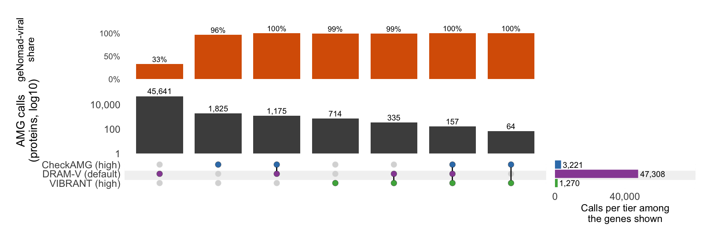<!-- -->

## Figure 3 UpSets by shared KO class

Figure 3A is the all-tier UpSet of the genes kept by the primary-tier
filter above, with DRAM-V (default) shown as the cumulative
auxiliary-score sets DRAM-V (aux 1), (aux 2) and (aux 3), the calls at
auxiliary score 1, at most 2 and at most 3, the last of which is DRAM-V
(default) itself. The intersection bars are drawn on a linear axis with
every count printed, and each bar is stacked by the four shared KO
classes of `amg_shared_kegg.ipynb` under the primary rule: a
geNomad-viral call with a KO under KEGG BRITE 09100 Metabolism, a
geNomad-viral call with another KO, a geNomad-viral call with no KO, and
a call off a geNomad-viral region. The figure names these classes
‘geNomad viral, Metabolism KO’, ‘geNomad viral, other KO’, ‘geNomad
viral, no KO’ and ‘Not geNomad viral’. The set-size bars carry the same
fill on a linear axis, because stacked segments on a log axis would not
be proportional, and count every filtered gene, including those of
omitted intersections. Each set-size bar is labeled ‘calls \| n (x%)’,
the filtered calls of the set, then those that are geNomad viral with a
Metabolism KO under the primary rule and their share of the set, and the
set-size axis title names the share as ‘viral, Metabolism KO’. The
sensitivity-rule fill and the Class I/II split are written to Source
Data only, and the Class I/II split also appears in Supplemental Table
9.

``` r
four_class_map <- c(
  "viral, KEGG Metabolism KO"    = "geNomad viral, Metabolism KO",
  "viral, KO outside Metabolism" = "geNomad viral, other KO",
  "viral, no KO"                 = "geNomad viral, no KO",
  "not geNomad viral"            = "Not geNomad viral"
)
four_class_pal <- setNames(c("#8A1257", "#C77B85", "#FDB462", "#BDBDBD"), unname(four_class_map))

fig3_tier_map <- c(
  "CheckAMG_high" = "CheckAMG (high)", "CheckAMG_medium" = "CheckAMG (medium)", "CheckAMG_low" = "CheckAMG (low)",
  "DRAMV_aux1" = "DRAM-V (aux 1)", "DRAMV_aux2" = "DRAM-V (aux 2)", "DRAMV_aux3" = "DRAM-V (aux 3)",
  "VIBRANT_high" = "VIBRANT (high)", "VIBRANT_medium" = "VIBRANT (medium)", "VIBRANT_low" = "VIBRANT (low)"
)
fig3_tool_sets <- list(
  "CheckAMG" = c("CheckAMG_high", "CheckAMG_medium", "CheckAMG_low"),
  "DRAM-V"   = c("DRAMV_aux1", "DRAMV_aux2", "DRAMV_aux3"),
  "VIBRANT"  = c("VIBRANT_high", "VIBRANT_medium", "VIBRANT_low")
)
fig3_tool_of <- function(s) ifelse(startsWith(s, "CheckAMG"), "CheckAMG", ifelse(startsWith(s, "VIBRANT"), "VIBRANT", "DRAM-V"))

fig3_genes <- gene_calls %>%
  select(gene_key, gene, sample, genomad_viral, all_of(union(names(fig3_tier_map), primary_tier_cols))) %>%
  left_join(shared_ko_classes, by = c("sample", "gene")) %>%
  mutate(fill_primary = factor(unname(four_class_map[S_S2_fill]), levels = unname(four_class_map)),
         fill_sensitivity = factor(unname(four_class_map[P_S2_fill]), levels = unname(four_class_map)))
stopifnot(nrow(fig3_genes) == nrow(gene_calls), !anyNA(fig3_genes$fill_primary), !anyNA(fig3_genes$fill_sensitivity))

fig3_upset_data <- fig3_genes %>%
  filter(if_any(all_of(primary_tier_cols))) %>%
  select(gene_key, fill_primary, fill_sensitivity, all_of(names(fig3_tier_map))) %>%
  dplyr::rename(!!!setNames(names(fig3_tier_map), fig3_tier_map)) %>%
  arrange(gene_key) %>%
  as.data.frame()
stopifnot(identical(fig3_upset_data$gene_key, upset_data_amg_calls$gene_key))

fig3_set_sizes <- tibble(set = unname(fig3_tier_map),
                         n_filtered = vapply(unname(fig3_tier_map), function(s) sum(fig3_upset_data[[s]]), integer(1)),
                         n_tier = vapply(names(fig3_tier_map), function(s) sum(gene_calls[[s]]), integer(1)))
cat("genes kept by the primary-tier filter:", nrow(fig3_upset_data), "of", nrow(gene_calls), "\n")
```

    ## genes kept by the primary-tier filter: 49911 of 306534

``` r
fig3_set_sizes
```

    ## # A tibble: 9 × 3
    ##   set               n_filtered n_tier
    ##   <chr>                  <int>  <int>
    ## 1 CheckAMG (high)         3221   3221
    ## 2 CheckAMG (medium)       4176   6728
    ## 3 CheckAMG (low)         14644 170161
    ## 4 DRAM-V (aux 1)          3380   3380
    ## 5 DRAM-V (aux 2)         13566  13566
    ## 6 DRAM-V (aux 3)         47308  47308
    ## 7 VIBRANT (high)          1270   1270
    ## 8 VIBRANT (medium)        2331   3720
    ## 9 VIBRANT (low)           5801  12677

``` r
fig3_min_size <- 12

# Stacked fill segments stay proportional only on a linear axis, so both bar axes are linear
fill_upset <- function(data, sets, label_angle, label_size, height_ratio, width_ratio, mat_text, show_legend, set_sizes,
                       bar_lab, title = NULL, min_size = fig3_min_size, point_size = 3.5, ytitle_inset = 0) {
  bars <- ComplexUpset::intersection_size(
    mapping = aes(fill = fill_primary),
    bar_number_threshold = 1,
    text_mapping = aes(label = scales::comma(!!ComplexUpset::get_size_mode("exclusive_intersection"))),
    text = list(size = label_size, angle = label_angle, vjust = if (label_angle == 0) -0.3 else 0.5,
                hjust = if (label_angle == 0) 0.5 else -0.1),
    text_colors = c(on_background = "black", on_bar = "black")
  ) +
    scale_fill_manual(values = four_class_pal, name = "Shared KO class", drop = FALSE,
                      labels = function(x) str_wrap(x, 30), guide = if (show_legend) "legend" else "none") +
    scale_y_continuous(expand = expansion(mult = c(0, if (label_angle == 0) 0.12 else 0.22)), labels = scales::comma) +
    labs(y = bar_lab) +
    coord_cartesian(clip = "off") +
    theme(panel.grid = element_blank(), axis.title.y = element_text(size = 14), axis.text.y = element_text(size = 12),
          legend.title = element_text(size = 14), legend.text = element_text(size = 12),
          plot.title = element_text(size = 14, face = "bold", hjust = 0.5, lineheight = 0.9))
  if (!is.null(title)) bars <- bars + ggtitle(title)
  # A negative right margin draws the y title over the empty space above the set labels
  if (ytitle_inset > 0) bars <- bars + theme(axis.title.y = element_text(size = 14, margin = margin(r = -ytitle_inset)))
  ComplexUpset::upset(
    data = data,
    intersect = rev(sets),
    name = NULL,
    sort_sets = FALSE,
    sort_intersections = "descending",
    sort_intersections_by = "cardinality",
    min_size = min_size,
    height_ratio = height_ratio, width_ratio = width_ratio, guides = if (show_legend) "over" else NULL,
    base_annotations = list("AMG calls (proteins)" = bars),
    matrix = ComplexUpset::intersection_matrix(
      geom = geom_point(size = point_size),
      segment = geom_segment(linetype = "solid", color = "black"),
      outline_color = list(active = "grey60", inactive = "grey90")
    ),
    themes = ComplexUpset::upset_modify_themes(
      list("intersections_matrix" = theme(axis.text.y = element_text(size = mat_text), axis.title.y = element_blank(), axis.title.x = element_blank()))
    ),
    queries = lapply(sets, function(s) upset_query(set = s, color = tool_pal[fig3_tool_of(s)], fill = tool_pal[fig3_tool_of(s)],
                                                   only_components = c("intersections_matrix"))),
    set_sizes = set_sizes
  )
}

# Shown and omitted intersections of an UpSet with the minimum size, for the figure and Source Data
intersection_counts <- function(data, sets, min_size = fig3_min_size) {
  data %>%
    mutate(intersection = intersection_name(data, sets)) %>%
    count(intersection, name = "n_calls") %>%
    mutate(shown = n_calls >= min_size)
}
intersection_name <- function(data, sets) {
  apply(as.matrix(data[sets]), 1, function(row) paste(sets[row], collapse = " & "))
}
```

``` r
fig3_metabolism_class <- unname(four_class_map["viral, KEGG Metabolism KO"])
fig3_set_label <- function(n, n_metabolism) {
  paste0(scales::comma(n), " | ", scales::comma(n_metabolism), " (", round(100 * n_metabolism / n), "%)")
}
fig3_set_labels <- tibble(
  set = unname(fig3_tier_map),
  set_calls = vapply(set, function(s) sum(fig3_upset_data[[s]]), integer(1)),
  set_viral_metabolism_ko = vapply(set, function(s) sum(fig3_upset_data[[s]] & fig3_upset_data$fill_primary == fig3_metabolism_class), integer(1))
) %>%
  mutate(set_viral_metabolism_ko_share = set_viral_metabolism_ko / set_calls,
         set_label = fig3_set_label(set_calls, set_viral_metabolism_ko))
fig3_set_labels
```

    ## # A tibble: 9 × 5
    ##   set          set_calls set_viral_metabolism…¹ set_viral_metabolism…² set_label
    ##   <chr>            <int>                  <int>                  <dbl> <chr>    
    ## 1 CheckAMG (h…      3221                   1751                  0.544 3,221 | …
    ## 2 CheckAMG (m…      4176                   2370                  0.568 4,176 | …
    ## 3 CheckAMG (l…     14644                   3010                  0.206 14,644 |…
    ## 4 DRAM-V (aux…      3380                   1637                  0.484 3,380 | …
    ## 5 DRAM-V (aux…     13566                   5404                  0.398 13,566 |…
    ## 6 DRAM-V (aux…     47308                  10244                  0.217 47,308 |…
    ## 7 VIBRANT (hi…      1270                   1161                  0.914 1,270 | …
    ## 8 VIBRANT (me…      2331                   2206                  0.946 2,331 | …
    ## 9 VIBRANT (lo…      5801                   5536                  0.954 5,801 | …
    ## # ℹ abbreviated names: ¹​set_viral_metabolism_ko, ²​set_viral_metabolism_ko_share

``` r
fig3_set_size_bars <- ComplexUpset::upset_set_size(geom = geom_bar(aes(x = group, fill = fill_primary), width = 0.8, show.legend = FALSE),
                                                   position = "right", filter_intersections = FALSE) +
  stat_summary(aes(x = group, y = as.numeric(fill_primary == fig3_metabolism_class)),
               fun.data = function(v) data.frame(y = length(v), label = fig3_set_label(length(v), sum(v))),
               geom = "text", hjust = -0.05, size = 3.5) +
  scale_fill_manual(values = four_class_pal, drop = FALSE, guide = "none") +
  scale_y_continuous(labels = scales::comma, expand = expansion(mult = c(0, 1.05)),
                     breaks = function(lim) Filter(function(b) b <= 0.8 * lim[2], scales::breaks_extended(3)(lim))) +
  labs(y = "Calls | Viral & Metabolism KO (%) per tier") +
  theme(axis.text.x = element_text(size = 12), axis.title.x = element_text(size = 12))
p_fig3_upset_all <- tighten_upset(fill_upset(fig3_upset_data, unname(fig3_tier_map), label_angle = 90, label_size = 3.5,
                                             height_ratio = 0.8, width_ratio = 0.3, mat_text = 12, show_legend = TRUE,
                                             set_sizes = fig3_set_size_bars, bar_lab = "AMG calls\n(number of proteins)"), 4, 10)
fig3_all_intersections <- intersection_counts(fig3_upset_data, unname(fig3_tier_map))
cat("intersections:", nrow(fig3_all_intersections), "shown:", sum(fig3_all_intersections$shown),
    "omitted genes:", sum(fig3_all_intersections$n_calls[!fig3_all_intersections$shown]), "\n")
```

    ## intersections: 50 shown: 40 omitted genes: 53

``` r
print(p_fig3_upset_all)
```

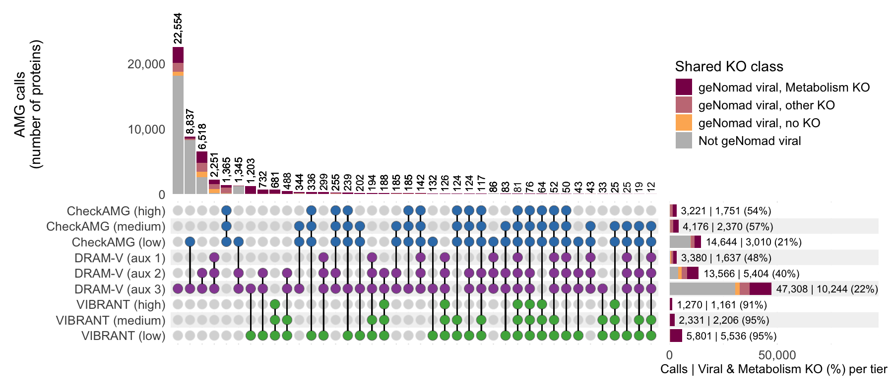<!-- -->

Figure 3B holds one UpSet per tool: each one holds one tool’s
primary-tier calls, its own primary tier as the top row and the other
tools’ tiers below. Intersections with fewer than 12 calls are omitted
from Figure 3A and from all three panels of Figure 3B. Omitted
intersections are kept in Source Data.

``` r
fig3_focal <- list(
  "CheckAMG" = list(filter = "CheckAMG_high", title = "CheckAMG\n(high)", min_size = fig3_min_size,
                    sets = c("CheckAMG_high", "DRAMV_aux1", "DRAMV_aux2", "DRAMV_aux3", "VIBRANT_high", "VIBRANT_medium", "VIBRANT_low")),
  "DRAM-V" = list(filter = "DRAMV_aux1", title = "DRAM-V\n(aux 1)", min_size = fig3_min_size,
                  sets = c("DRAMV_aux1", "CheckAMG_high", "CheckAMG_medium", "CheckAMG_low",
                           "VIBRANT_high", "VIBRANT_medium", "VIBRANT_low")),
  "VIBRANT" = list(filter = "VIBRANT_high", title = "VIBRANT\n(high)", min_size = fig3_min_size,
                   sets = c("VIBRANT_high", "CheckAMG_high", "CheckAMG_medium", "CheckAMG_low", "DRAMV_aux1", "DRAMV_aux2", "DRAMV_aux3"))
)
fig3_focal_data <- lapply(fig3_focal, function(f) {
  fig3_genes %>%
    filter(.data[[f$filter]]) %>%
    select(gene_key, fill_primary, fill_sensitivity, all_of(f$sets)) %>%
    dplyr::rename(!!!setNames(f$sets, fig3_tier_map[f$sets])) %>%
    as.data.frame()
})
fig3_focal_intersections <- lapply(names(fig3_focal), function(tool) {
  intersection_counts(fig3_focal_data[[tool]], unname(fig3_tier_map[fig3_focal[[tool]]$sets]), fig3_focal[[tool]]$min_size)
})
names(fig3_focal_intersections) <- names(fig3_focal)
tibble(focal_tool = names(fig3_focal), n_focal_calls = vapply(fig3_focal_data, nrow, integer(1)),
       intersections = vapply(fig3_focal_intersections, nrow, integer(1)),
       shown = vapply(fig3_focal_intersections, function(x) sum(x$shown), integer(1)))
```

    ## # A tibble: 3 × 4
    ##   focal_tool n_focal_calls intersections shown
    ##   <chr>              <int>         <int> <int>
    ## 1 CheckAMG            3221            15    14
    ## 2 DRAM-V              3380            16    12
    ## 3 VIBRANT             1270            12     7

``` r
p_fig3_focal <- lapply(names(fig3_focal), function(tool) {
  tighten_upset(fill_upset(fig3_focal_data[[tool]], unname(fig3_tier_map[fig3_focal[[tool]]$sets]), label_angle = 90, label_size = 3.5,
                           height_ratio = 0.9, width_ratio = 0.3, mat_text = 12, show_legend = FALSE, set_sizes = FALSE,
                           bar_lab = "AMG calls\n(number of proteins)", title = fig3_focal[[tool]]$title,
                           min_size = fig3_focal[[tool]]$min_size, point_size = 1.5, ytitle_inset = 30), 2, 4)
})
# A constant ratio overplots DRAM-V counts, so width is a label column plus one unit per bar
fig3_focal_widths <- vapply(fig3_focal_intersections, function(x) sum(x$shown), integer(1)) + 16
p_fig3_upset_per_tool <- cowplot::plot_grid(plotlist = p_fig3_focal, nrow = 1, rel_widths = fig3_focal_widths)
print(p_fig3_upset_per_tool)
```

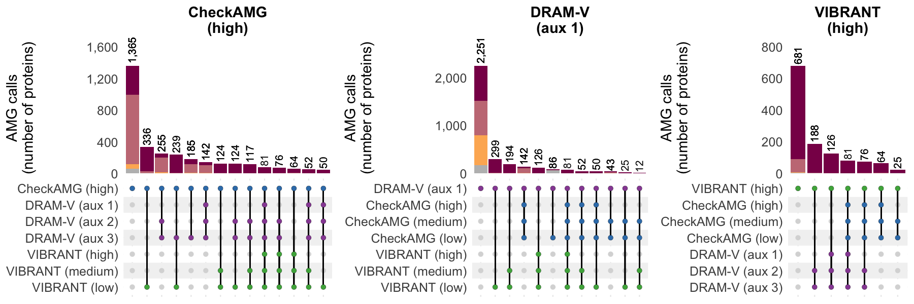<!-- -->

## All-tier UpSet by sequence source

The Extended Data all-tier UpSet holds the same genes on twelve sets:
the nine Figure 3 sets, with DRAM-V (default) shown as the cumulative
sets DRAM-V (aux 1), (aux 2) and (aux 3), and the DRAM-V (allow T),
DRAM-V (aux 4) and DRAM-V (aux 4, allow T) configurations in full.
Intersection bars are drawn on a log10 axis, no intersection is omitted,
and the annotation track gives the sequence-source composition of each
intersection. Intersection and set-size bars are split by the four
shared KO classes of Figure 3A under the primary rule, with the same
order and colors. Because intersection bars are on a log10 axis, each
class takes its share of the bar’s drawn length rather than ending at
its count. Each set-size bar is labeled ‘calls \| n (x%) \| n (x%) \| n
(x%) \| n (x%)’, the calls of the set, then the calls and share of the
set in each class in legend order: geNomad viral with a Metabolism KO,
geNomad viral with another KO, geNomad viral with no KO, and not geNomad
viral.

``` r
source_track <- list(
  "Share by sequence source" = ggplot(mapping = aes(x = intersection, fill = source)) +
    geom_bar(position = "fill", width = 0.8) +
    scale_fill_manual(values = source_pal, name = "Sequence source", drop = FALSE) +
    scale_y_continuous(breaks = c(0, 0.5, 1), labels = label_percent(scale = 100), expand = expansion(mult = c(0, 0))) +
    labs(y = "Share by sequence source") +
    theme(panel.grid = element_blank(), axis.title.y = element_text(size = 14), axis.text.y = element_text(size = 12),
          legend.title = element_text(size = 14), legend.text = element_text(size = 12))
)

ed7_tier_map <- c(
  fig3_tier_map[fig3_tool_sets$CheckAMG], fig3_tier_map[fig3_tool_sets$`DRAM-V`],
  tier_pretty_map[c("DRAMV_allow_T", "DRAMV_aux_4", "DRAMV_aux_4_allow_T")], fig3_tier_map[fig3_tool_sets$VIBRANT]
)
ed7_upset_data <- gene_calls %>%
  select(gene_key, source, all_of(names(ed7_tier_map))) %>%
  left_join(select(fig3_genes, gene_key, shared_ko_class = fill_primary), by = "gene_key") %>%
  dplyr::rename(!!!setNames(names(ed7_tier_map), ed7_tier_map)) %>%
  mutate(source = factor(source, levels = names(source_pal))) %>%
  arrange(gene_key) %>%
  as.data.frame()
# Every gene of gene_calls is called at one of these twelve sets, so the primary-tier filter of the other UpSets would drop nothing it should keep
stopifnot(nrow(ed7_upset_data) == nrow(gene_calls), !anyNA(ed7_upset_data$source), !anyNA(ed7_upset_data$shared_ko_class),
          all(rowSums(ed7_upset_data[unname(ed7_tier_map)]) > 0))
ed7_intersections <- intersection_counts(ed7_upset_data, unname(ed7_tier_map), min_size = 1)
cat("intersections:", nrow(ed7_intersections), "shown:", sum(ed7_intersections$shown), "largest:", max(ed7_intersections$n_calls), "\n")
```

    ## intersections: 92 shown: 92 largest: 124497

``` r
# Count ticks stop at the largest bar, so the top count tick cannot meet the 0% tick of the share track
p_upset_all_tiers <- tighten_upset(log_upset(ed7_upset_data, unname(ed7_tier_map), source_track,
                                             label_angle = 90, label_size = 3, height_ratio = 0.8, width_ratio = 0.32, point_size = 1.5,
                                             set_size_lab = "Calls | viral, Metabolism KO | viral, other KO |\nviral, no KO | not viral (%) per tier",
                                             class_col = "shared_ko_class", class_pal = four_class_pal, class_name = "Shared KO class",
                                             set_label_size = 3, set_size_expand = 3.8,
                                             queries = lapply(unname(ed7_tier_map), function(s) {
                                               upset_query(set = s, color = tool_pal[fig3_tool_of(s)], fill = tool_pal[fig3_tool_of(s)],
                                                           only_components = c("intersections_matrix"))
                                             }),
                                             count_breaks = 10^(0:floor(log10(max(ed7_intersections$n_calls))))), 4, 10)
print(p_upset_all_tiers)
```

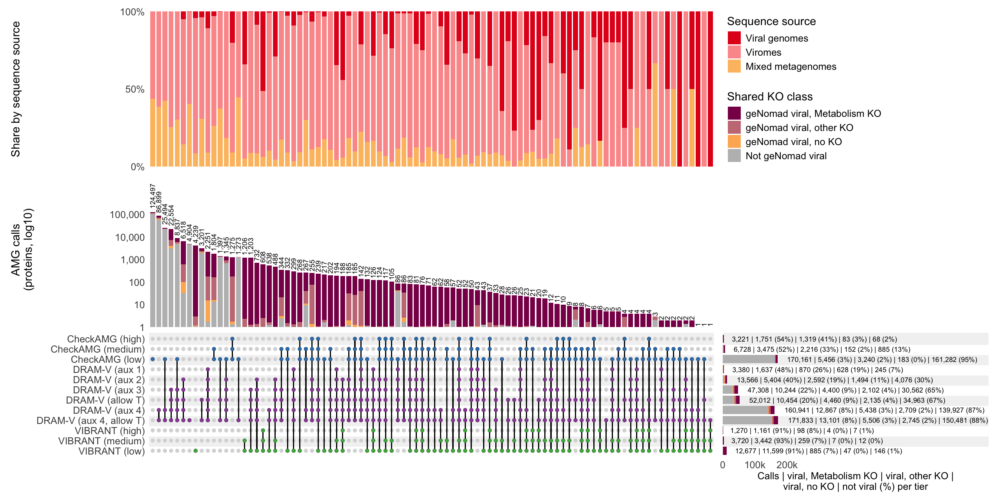<!-- -->

## Primary-tier calls also called by the other tools

For each tool, the calls of its primary tier (CheckAMG (high), DRAM-V
(aux 1), VIBRANT (high)) and how many of them each other tool also
called, either at that tool’s primary tier or at any of its Figure 3
tiers. ‘Any tier’ is CheckAMG (low), DRAM-V (aux 3), which is DRAM-V
(default), or VIBRANT (high), (medium) or (low) as VIBRANT (low), and a
‘not’ in a row applies at the same level as the column, so ‘DRAM-V, not
VIBRANT’ at the primary tier counts calls of DRAM-V (aux 1) that are not
in VIBRANT (high).

``` r
overlap_primary_sets <- c("CheckAMG" = "CheckAMG (high)", "DRAM-V" = "DRAM-V (aux 1)", "VIBRANT" = "VIBRANT (high)")
overlap_tool_sets <- lapply(fig3_tool_sets, function(x) unname(fig3_tier_map[x]))
overlap_levels <- c("primary tier", "any tier")
called_by <- function(tool, level) {
  if (level == "primary tier") ed7_upset_data[[overlap_primary_sets[[tool]]]] else rowSums(ed7_upset_data[overlap_tool_sets[[tool]]]) > 0
}

primary_tier_overlap <- map_dfr(names(overlap_primary_sets), function(focal) {
  focal_calls <- ed7_upset_data[[overlap_primary_sets[[focal]]]]
  others <- setdiff(names(overlap_primary_sets), focal)
  map_dfr(overlap_levels, function(level) {
    a <- called_by(others[1], level)[focal_calls]
    b <- called_by(others[2], level)[focal_calls]
    combos <- list(a | b, a, b, a & !b, b & !a, a & b)
    names(combos) <- c(paste(others[1], "or", others[2]), others[1], others[2],
                       paste0(others[1], ", not ", others[2]), paste0(others[2], ", not ", others[1]), paste(others[1], "and", others[2]))
    stopifnot(sum(combos[[1]]) == sum(combos[[4]]) + sum(combos[[5]]) + sum(combos[[6]]))
    tibble(focal_tier = overlap_primary_sets[[focal]], n_primary = sum(focal_calls), also_called_by = names(combos),
           row = seq_along(combos), other_tier = level, n = vapply(combos, sum, integer(1)))
  })
}) %>%
  mutate(pct = n / n_primary)

primary_tier_overlap_table <- primary_tier_overlap %>%
  mutate(cell = paste0(scales::comma(n), " (", sprintf("%.1f", 100 * pct), "%)")) %>%
  select(focal_tier, n_primary, row, also_called_by, other_tier, cell) %>%
  pivot_wider(names_from = other_tier, values_from = cell) %>%
  arrange(factor(focal_tier, levels = overlap_primary_sets), row) %>%
  select(primary_tier = focal_tier, calls = n_primary, also_called_by,
         at_other_primary_tier = `primary tier`, at_any_other_tier = `any tier`) %>%
  as.data.frame()
print(primary_tier_overlap_table, right = FALSE)
```

    ##    primary_tier    calls also_called_by        at_other_primary_tier
    ## 1  CheckAMG (high) 3221  DRAM-V or VIBRANT     465 (14.4%)          
    ## 2  CheckAMG (high) 3221  DRAM-V                325 (10.1%)          
    ## 3  CheckAMG (high) 3221  VIBRANT               221 (6.9%)           
    ## 4  CheckAMG (high) 3221  DRAM-V, not VIBRANT   244 (7.6%)           
    ## 5  CheckAMG (high) 3221  VIBRANT, not DRAM-V   140 (4.3%)           
    ## 6  CheckAMG (high) 3221  DRAM-V and VIBRANT    81 (2.5%)            
    ## 7  DRAM-V (aux 1)  3380  CheckAMG or VIBRANT   463 (13.7%)          
    ## 8  DRAM-V (aux 1)  3380  CheckAMG              325 (9.6%)           
    ## 9  DRAM-V (aux 1)  3380  VIBRANT               219 (6.5%)           
    ## 10 DRAM-V (aux 1)  3380  CheckAMG, not VIBRANT 244 (7.2%)           
    ## 11 DRAM-V (aux 1)  3380  VIBRANT, not CheckAMG 138 (4.1%)           
    ## 12 DRAM-V (aux 1)  3380  CheckAMG and VIBRANT  81 (2.4%)            
    ## 13 VIBRANT (high)  1270  CheckAMG or DRAM-V    359 (28.3%)          
    ## 14 VIBRANT (high)  1270  CheckAMG              221 (17.4%)          
    ## 15 VIBRANT (high)  1270  DRAM-V                219 (17.2%)          
    ## 16 VIBRANT (high)  1270  CheckAMG, not DRAM-V  140 (11.0%)          
    ## 17 VIBRANT (high)  1270  DRAM-V, not CheckAMG  138 (10.9%)          
    ## 18 VIBRANT (high)  1270  CheckAMG and DRAM-V   81 (6.4%)            
    ##    at_any_other_tier
    ## 1  1,856 (57.6%)    
    ## 2  1,332 (41.4%)    
    ## 3  1,274 (39.6%)    
    ## 4  582 (18.1%)      
    ## 5  524 (16.3%)      
    ## 6  750 (23.3%)      
    ## 7  1,129 (33.4%)    
    ## 8  510 (15.1%)      
    ## 9  858 (25.4%)      
    ## 10 271 (8.0%)       
    ## 11 619 (18.3%)      
    ## 12 239 (7.1%)       
    ## 13 589 (46.4%)      
    ## 14 275 (21.7%)      
    ## 15 492 (38.7%)      
    ## 16 97 (7.6%)        
    ## 17 314 (24.7%)      
    ## 18 178 (14.0%)

# Prediction tier composition

## AMG weight composition

Each call can carry several annotations and AMG weights. The weight of a
call is the maximum AMG weight across all of the calling tool’s final
annotations of the gene, read with its bin from
`AMG_call_weight_caution.parquet`, which
`amg_benchmark_comparisons.ipynb` writes so that the notebook and these
figures use one computation. The annotation with that weight represents
each tool and tier in the database panel, or the strongest hit by
bitscore where no annotation carries a weight, so the database panel
always reports a real database. DRAM-V calls are scored on the
identifier DRAM-V used to make the call, the `gene_id` of
`amg_summary.tsv`, which `amg_benchmark_comparisons.ipynb` writes as the
DRAM-V rows of the annotation export, so KEGG KOs, Pfam accessions,
MEROPS family ids, EC numbers, and dbCAN family names all count. An EC
number is assigned to KEGG, because each is the EC of the call’s KOfam
hit. A DRAM-V call whose `gene_id` is in neither `AMGs.tsv` nor
`AMG_filters.tsv` is labeled “Annotated, no AMG weight”. CheckAMG and
VIBRANT calls are scored on their final annotations, and those with no
final annotation from the calling tool are kept and labeled “No
annotation”.

The all-tier panels of the Extended Data use twelve sets: CheckAMG and
VIBRANT high, medium and low, and six cumulative DRAM-V sets. DRAM-V
(aux 1), (aux 2) and (aux 3) hold the DRAM-V (default) calls at
auxiliary score 1, at most 2 and at most 3, the last being DRAM-V
(default) itself, and DRAM-V (allow T), (aux 4) and (aux 4, allow T) are
the full relaxed configurations as in the all-tier UpSet. The check
below confirms that each DRAM-V set contains the sets before it, with
DRAM-V (allow T) and DRAM-V (aux 4) both inside DRAM-V (aux 4, allow T).
As in Figure 3, the CheckAMG and VIBRANT sets are cumulative, so a call
at high also counts at medium and low. Every call of a set is counted,
without the primary-tier filter of the UpSets. The weight, weight bin,
database and cautious category of a DRAM-V call are the same under every
DRAM-V configuration, which the check below confirms for weight, bin and
database, so each DRAM-V set takes its calls’ rows of the configuration
it is drawn from.

``` r
tier_calls <- gene_calls %>%
  select(gene_key, all_of(prediction_cols)) %>%
  pivot_longer(
    cols = all_of(prediction_cols),
    names_to = "tier",
    values_to = "Predicted AMG"
  ) %>%
  filter(`Predicted AMG`) %>%
  mutate(
    tool = case_when(
      tier %in% tool_tier_cols$CheckAMG ~ "CheckAMG",
      tier %in% tool_tier_cols$`DRAM-V` ~ "DRAM-V",
      tier %in% tool_tier_cols$VIBRANT ~ "VIBRANT"
    ),
    tier = factor(recode(tier, !!!tier_pretty_map), levels = tier_order_pretty)
  )

# Same evidence order as _best_hit_per_gene in amg_benchmark_comparisons.ipynb
best_annotation_per_call <- final_annotations %>%
  arrange(gene_key, tool, desc(AMG_weight), desc(bitscore), evalue, hit_id) %>%
  distinct(gene_key, tool, .keep_all = TRUE) %>%
  select(gene_key, tool, AMG_weight, database, hit_id)

call_weights <- call_weight_caution %>%
  transmute(gene_key, tool, tier = factor(recode(tier, !!!tier_pretty_map), levels = tier_order_pretty),
            `AMG weight` = best_AMG_weight, weight_bin)

amg_weight_comp <- tier_calls %>%
  left_join(call_weights, by = c("gene_key", "tool", "tier")) %>%
  left_join(best_annotation_per_call, by = c("gene_key", "tool")) %>%
  mutate(
    database = case_when(
      is.na(hit_id) ~ "No annotation",
      database == "METABOLIC" ~ "METABOLIC (custom)",
      database == "CAMPER" ~ "CAMPER (custom)",
      TRUE ~ database
    ),
    database = factor(database, levels = db_source_levels),
    `AMG weight bin` = recode(weight_bin, !!!weight_bin_label),
    `Likely AMG` = case_when(
      `AMG weight` >= 0.6 ~ "Likely AMG (weight ≥ 0.6)",
      `AMG weight` < 0.6 ~ "Unlikely AMG (weight < 0.6)",
      is.na(`AMG weight`) ~ "No mapped AMG weight"
    ),
    `AMG weight bin` = factor(
      `AMG weight bin`,
      levels = c(
        "AMG weight ≥ 0.8",
        "AMG weight 0.6 to 0.8",
        "AMG weight 0.4 to 0.6",
        "AMG weight < 0.4",
        "Annotated, no AMG weight",
        "No annotation"
      )
    )
  )

stopifnot(
  !any(is.na(amg_weight_comp$database)),
  !any(amg_weight_comp$tool == "DRAM-V" & amg_weight_comp$database == "No annotation"),
  !any(is.na(amg_weight_comp$`AMG weight bin`)),
  identical(is.na(amg_weight_comp$AMG_weight), is.na(amg_weight_comp$`AMG weight`)),
  all(amg_weight_comp$AMG_weight == amg_weight_comp$`AMG weight`, na.rm = TRUE)
)
amg_weight_comp <- amg_weight_comp %>% select(-AMG_weight, -weight_bin)

head(amg_weight_comp)
```

    ## # A tibble: 6 × 9
    ##   gene_key              tier  `Predicted AMG` tool  `AMG weight` database hit_id
    ##   <chr>                 <fct> <lgl>           <chr>        <dbl> <fct>    <chr> 
    ## 1 Ga0485157_0000001_10… Chec… TRUE            Chec…        0.713 KEGG     K04708
    ## 2 Ga0485157_0000001_10… DRAM… TRUE            DRAM…       NA     Pfam     PF001…
    ## 3 Ga0485157_0000001_10… DRAM… TRUE            DRAM…       NA     Pfam     PF001…
    ## 4 Ga0485157_0000001_10… Chec… TRUE            Chec…        0.942 KEGG     K00097
    ## 5 Ga0485157_0000001_11… Chec… TRUE            Chec…        0.667 KEGG     K00631
    ## 6 Ga0485157_0000001_12… DRAM… TRUE            DRAM…       NA     KEGG     K02986
    ## # ℹ 2 more variables: `AMG weight bin` <fct>, `Likely AMG` <chr>

``` r
stopifnot(!anyDuplicated(distinct(filter(amg_weight_comp, tool == "DRAM-V"), gene_key, `AMG weight bin`, database, hit_id)$gene_key))
ed_dramv_sets <- c(
  "DRAMV_aux1" = "DRAMV_default", "DRAMV_aux2" = "DRAMV_default", "DRAMV_aux3" = "DRAMV_default",
  "DRAMV_allow_T" = "DRAMV_allow_T", "DRAMV_aux_4" = "DRAMV_aux_4", "DRAMV_aux_4_allow_T" = "DRAMV_aux_4_allow_T"
)
ed_tier_map <- c(
  fig3_tier_map[fig3_tool_sets$CheckAMG], fig3_tier_map[fig3_tool_sets$`DRAM-V`],
  tier_pretty_map[c("DRAMV_allow_T", "DRAMV_aux_4", "DRAMV_aux_4_allow_T")],
  fig3_tier_map[fig3_tool_sets$VIBRANT]
)
ed_set_genes <- gene_calls %>%
  select(gene_key, all_of(names(ed_tier_map)))
stopifnot(all(ed_set_genes$DRAMV_aux1 <= ed_set_genes$DRAMV_aux2), all(ed_set_genes$DRAMV_aux2 <= ed_set_genes$DRAMV_aux3),
          all(ed_set_genes$DRAMV_aux3 <= ed_set_genes$DRAMV_allow_T), all(ed_set_genes$DRAMV_aux3 <= ed_set_genes$DRAMV_aux_4),
          all((ed_set_genes$DRAMV_allow_T | ed_set_genes$DRAMV_aux_4) <= ed_set_genes$DRAMV_aux_4_allow_T))
tibble(set = unname(ed_tier_map[names(ed_dramv_sets)]),
       calls = vapply(names(ed_dramv_sets), function(s) sum(ed_set_genes[[s]]), integer(1)))
```

    ## # A tibble: 6 × 2
    ##   set                      calls
    ##   <chr>                    <int>
    ## 1 DRAM-V (aux 1)            3380
    ## 2 DRAM-V (aux 2)           13566
    ## 3 DRAM-V (aux 3)           47308
    ## 4 DRAM-V (allow T)         52012
    ## 5 DRAM-V (aux 4)          160941
    ## 6 DRAM-V (aux 4, allow T) 171833

``` r
ed_set_calls <- ed_set_genes %>%
  pivot_longer(-gene_key, names_to = "set_code", values_to = "called") %>%
  filter(called) %>%
  transmute(gene_key, set = factor(unname(ed_tier_map[set_code]), levels = unname(ed_tier_map)),
            source_tier = factor(unname(tier_pretty_map[if_else(set_code %in% names(ed_dramv_sets), ed_dramv_sets[set_code], set_code)]),
                                 levels = tier_order_pretty))
to_ed_sets <- function(calls) {
  out <- ed_set_calls %>%
    inner_join(calls, by = c("gene_key", source_tier = "tier")) %>%
    mutate(tier = set, .after = tool) %>%
    select(-set, -source_tier)
  stopifnot(nrow(out) == nrow(ed_set_calls))
  out
}
amg_weight_comp_sets <- to_ed_sets(amg_weight_comp)
fig3_comp_tiers <- c("CheckAMG (high)", "DRAM-V (aux 1)", "VIBRANT (high)")
amg_weight_comp_fig3 <- amg_weight_comp_sets %>% filter(tier %in% fig3_comp_tiers) %>% mutate(tier = droplevels(tier))

# Shares of a tool and tier on all calls, without the scorable share
composition_shares <- function(calls, category) {
  calls %>%
    group_by(tool, tier, {{ category }}) %>%
    summarise(n = n(), .groups = "drop") %>%
    group_by(tool, tier) %>%
    mutate(
      pct = n / sum(n),
      n_tier = sum(n)
    ) %>%
    ungroup()
}
```

``` r
p_weight_composition <- ggplot(
  amg_weight_comp_fig3 %>%
    filter(`Predicted AMG`),
  aes(
    x = tier,,
    fill = `AMG weight bin`
  )
) +
  geom_bar(
    position = "fill"
  ) +
  geom_text(
    stat = "count",
    size = 3.5,
    color = "white",
    aes(
      label = after_stat(
        ifelse(
          count / tapply(count, x, sum)[x] >= 0.05,
          paste0(round(100 * count / tapply(count, x, sum)[x], 0), "%"),
          ""
        )
      )
    ),
    position = position_fill(vjust = 0.5),
  ) +
  scale_fill_manual(
    values = weight_pal,
    name = "AMG weight",
    drop = TRUE
  ) +
  scale_y_continuous(
    labels = label_percent(scale = 100),
    expand = expansion(mult = c(0, 0.02))
  ) +
  labs(
    x = "Confidence tier",
    y = "Percent of tier"
  ) +
  coord_cartesian(clip = "off") +
  theme(
    legend.position = "bottom",
    legend.justification = "left",
    legend.location = "plot",
    legend.margin = margin(0, 0, 0, 0),
    plot.margin = margin(t = 16, r = 6, b = 4, l = 14),
    legend.key.size = unit(0.6, "lines"),
    legend.title.position = "top",
    legend.title = element_text(size = 14),
    legend.text = element_text(size = 12),
    axis.title.y = element_text(size = 14),
    axis.text.y = element_text(size = 12),
    axis.title.x = element_blank(),
    axis.text.x = element_text(size = 12, angle = 22.5, hjust = 1)
  ) +
  guides(
    fill = guide_legend(
      nrow = 6,
      title.position = "top"
    )
  )

print(p_weight_composition)
```

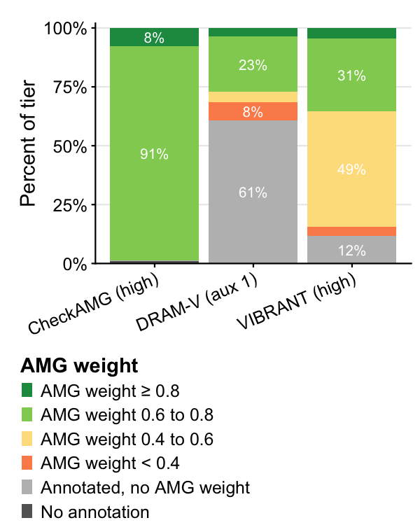<!-- -->

``` r
weight_comp_plot <- amg_weight_comp_sets %>%
  composition_shares(`AMG weight bin`)

p_weight_composition_all_tiers <- ggplot(
  weight_comp_plot,
  aes(
    x = tier,
    y = pct,
    fill = `AMG weight bin`
  )
) +
  geom_col() +
  geom_text(
    aes(
      label = ifelse(pct >= 0.05, paste0(round(100 * pct, 0), "%"), "")
    ),
    position = position_stack(vjust = 0.5),
    size = 5.0,
    color = "white"
  ) +
  facet_grid(
    . ~ tool,
    scales = "free_x",
    space = "free_x"
  ) +
  scale_fill_manual(
    values = weight_pal,
    name = "AMG weight",
    labels = function(x) str_wrap(x, 30),
    drop = TRUE
  ) +
  scale_y_continuous(
    labels = label_percent(scale = 100),
    expand = expansion(mult = c(0, 0.02))
  ) +
  guides(
    fill = guide_legend(ncol = 1)
  ) +
  labs(
    x = "Confidence tier",
    y = "Percent of tier"
  ) +
  coord_cartesian(clip = "off") +
  theme(
    legend.position = "bottom",
    legend.title.position = "top",
    legend.title = element_text(size = 16),
    legend.text = element_text(size = 14),
    axis.title.y = element_text(size = 16),
    axis.text.y = element_text(size = 14),
    axis.title.x = element_text(size = 16),
    axis.text.x = element_text(size = 14, angle = 45, hjust = 1),
    strip.text.x = element_text(size = 16)
  ) +
  guides(
    fill = guide_legend(
      ncol = 3,
      title.position = "top"
    )
  )

print(p_weight_composition_all_tiers)
```

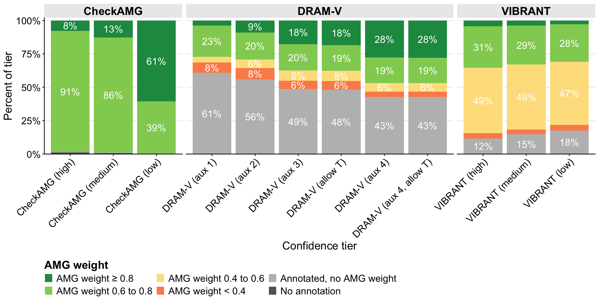<!-- -->

## Database composition

``` r
p_db_composition <- ggplot(
  amg_weight_comp_fig3 %>%
    filter(`Predicted AMG`),
  aes(
    x = tier,,
    fill = database
  )
) +
  geom_bar(
    position = "fill"
  ) +
  geom_text(
    stat = "count",
    size = 3.5,
    color = "white",
    aes(
      label = after_stat(
        ifelse(
          count / tapply(count, x, sum)[x] >= 0.05,
          paste0(round(100 * count / tapply(count, x, sum)[x], 0), "%"),
          ""
        )
      )
    ),
    position = position_fill(vjust = 0.5),
  ) +
  scale_fill_manual(
    values = db_source_pal,
    name = "Database source",
    drop = TRUE
  ) +
  scale_y_continuous(
    labels = label_percent(scale = 100),
    expand = expansion(mult = c(0, 0.02))
  ) +
  labs(
    x = "Confidence tier",
    y = "Percent of tier"
  ) +
  coord_cartesian(clip = "off") +
  theme(
    legend.position = "bottom",
    legend.justification = "left",
    legend.location = "plot",
    legend.margin = margin(0, 0, 0, 0),
    plot.margin = margin(t = 16, r = 6, b = 4, l = 14),
    legend.key.size = unit(0.6, "lines"),
    legend.title.position = "top",
    legend.title = element_text(size = 14),
    legend.text = element_text(size = 12),
    axis.title.y = element_text(size = 14),
    axis.text.y = element_text(size = 12),
    axis.title.x = element_blank(),
    axis.text.x = element_text(size = 12, angle = 22.5, hjust = 1)
  ) +
  guides(
    fill = guide_legend(
      nrow = 6,
      title.position = "top"
    )
  )

print(p_db_composition)
```

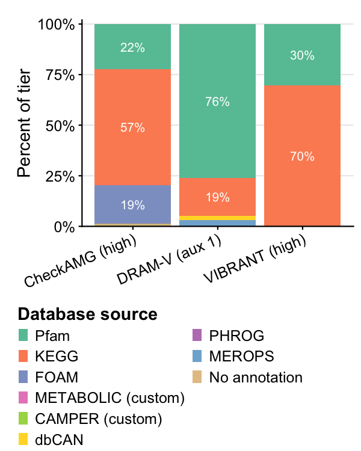<!-- -->

``` r
db_comp_plot <- amg_weight_comp_sets %>%
  count(tool, tier, database) %>%
  group_by(tool, tier) %>%
  mutate(
    pct = n / sum(n)
  ) %>%
  ungroup()

p_db_composition_all_tiers <- ggplot(
  db_comp_plot,
  aes(
    x = tier,
    y = pct,
    fill = database
  )
) +
  geom_col() +
  geom_text(
    aes(
      label = ifelse(pct >= 0.05, paste0(round(100 * pct, 0), "%"), "")
    ),
    position = position_stack(vjust = 0.5),
    size = 5.0,
    color = "white"
  ) +
  facet_grid(
    . ~ tool,
    scales = "free_x",
    space = "free_x"
  ) +
  scale_fill_manual(
    values = db_source_pal,
    name = "Database source",
    drop = TRUE
  ) +
  scale_y_continuous(
    labels = label_percent(scale = 100),
    expand = expansion(mult = c(0, 0.02))
  ) +
  guides(
    fill = guide_legend(ncol = 1)
  ) +
  labs(
    x = "Confidence tier",
    y = "Percent of tier"
  ) +
  coord_cartesian(clip = "off") +
  theme(
    legend.position = "right",
    legend.title.position = "top",
    legend.title = element_text(size = 16),
    legend.text = element_text(size = 14),
    axis.title.y = element_text(size = 16),
    axis.text.y = element_text(size = 14),
    axis.title.x = element_text(size = 16),
    axis.text.x = element_text(size = 14, angle = 45, hjust = 1),
    strip.text.x = element_text(size = 16),
    plot.margin = margin(t = 5.5, r = 5.5, b = 5.5, l = 24)
  ) +
  guides(
    fill = guide_legend(
      ncol = 1,
      title.position = "top"
    )
  )

print(p_db_composition_all_tiers)
```

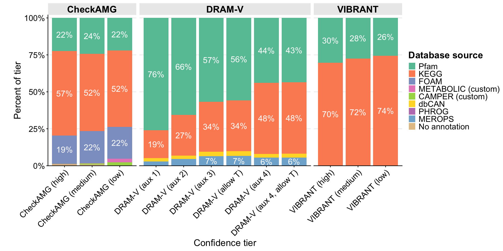<!-- -->

## Cautious function composition across all tiers

Cautious-function flags are OR-aggregated across all of the calling
tool’s final annotations of a gene, and a call with more than one flag
takes the flag least common within its tool and tier. A call with no
flag is split on its weight: at least 0.6, below 0.6, or no weight. The
category is read from `AMG_call_weight_caution.parquet`, computed once
in `amg_benchmark_comparisons.ipynb`.

``` r
amg_cautious_comp <- amg_weight_comp %>%
  left_join(
    call_weight_caution %>%
      transmute(gene_key, tool, tier = factor(recode(tier, !!!tier_pretty_map), levels = tier_order_pretty),
                cautious_category),
    by = c("gene_key", "tool", "tier")
  ) %>%
  mutate(`Cautious functions` = factor(recode(cautious_category, !!!category_label),
                                       levels = unname(category_label[category_order]))) %>%
  select(gene_key, tier, `Predicted AMG`, tool, `Cautious functions`, `Likely AMG`)
amg_cautious_comp_fig3 <- to_ed_sets(amg_cautious_comp) %>% filter(tier %in% fig3_comp_tiers) %>% mutate(tier = droplevels(tier))

stopifnot(!any(is.na(amg_cautious_comp$`Cautious functions`)))

head(amg_cautious_comp)
```

    ## # A tibble: 6 × 6
    ##   gene_key         tier  `Predicted AMG` tool  `Cautious functions` `Likely AMG`
    ##   <chr>            <fct> <lgl>           <chr> <fct>                <chr>       
    ## 1 Ga0485157_00000… Chec… TRUE            Chec… Not cautious (weigh… Likely AMG …
    ## 2 Ga0485157_00000… DRAM… TRUE            DRAM… Lipid metabolism     No mapped A…
    ## 3 Ga0485157_00000… DRAM… TRUE            DRAM… Lipid metabolism     No mapped A…
    ## 4 Ga0485157_00000… Chec… TRUE            Chec… Not cautious (weigh… Likely AMG …
    ## 5 Ga0485157_00000… Chec… TRUE            Chec… Lipid metabolism     Likely AMG …
    ## 6 Ga0485157_00000… DRAM… TRUE            DRAM… Not cautious (no we… No mapped A…

``` r
p_category_composition <- ggplot(
  amg_cautious_comp_fig3 %>%
    filter(`Predicted AMG`),
  aes(
    x = tier,,
    fill = `Cautious functions`
  )
) +
  geom_bar(
    position = "fill"
  ) +
  geom_text(
    stat = "count",
    aes(
      label = after_stat(
        ifelse(
          count / tapply(count, x, sum)[x] >= 0.05,
          paste0(round(100 * count / tapply(count, x, sum)[x], 0), "%"),
          ""
        )
      )
    ),
    position = position_fill(vjust = 0.5),
    size = 3.5,
    color = "white"
  ) +
  scale_fill_manual(
    values = category_pal,
    name = "Cautious functions",
    drop = TRUE
  ) +
  scale_y_continuous(
    labels = label_percent(scale = 100),
    expand = expansion(mult = c(0, 0.02))
  ) +
  labs(
    x = "Confidence tier",
    y = "Percent of tier"
  ) +
  coord_cartesian(clip = "off") +
  theme(
    legend.position = "bottom",
    legend.justification = "left",
    legend.location = "plot",
    legend.margin = margin(0, 0, 0, 0),
    plot.margin = margin(t = 16, r = 6, b = 4, l = 14),
    legend.key.size = unit(0.6, "lines"),
    legend.title.position = "top",
    legend.title = element_text(size = 14),
    legend.text = element_text(size = 12),
    axis.title.y = element_text(size = 14),
    axis.text.y = element_text(size = 12),
    axis.title.x = element_blank(),
    axis.text.x = element_text(size = 12, angle = 22.5, hjust = 1)
  ) +
  guides(
    fill = guide_legend(
      nrow = 6,
      title.position = "top"
    )
  )
print(p_category_composition)
```

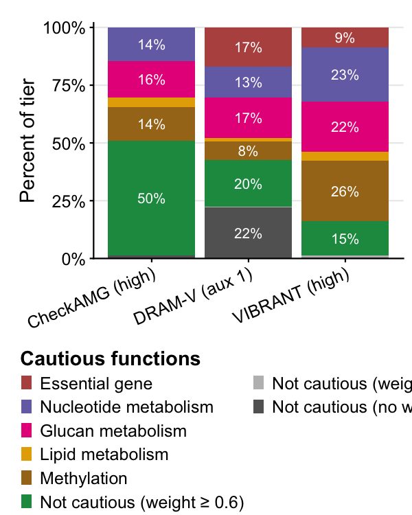<!-- -->

``` r
stopifnot(!anyDuplicated(distinct(filter(amg_cautious_comp, tool == "DRAM-V"), gene_key, `Cautious functions`)$gene_key))
cautious_comp_plot <- to_ed_sets(amg_cautious_comp) %>%
  composition_shares(`Cautious functions`)

p_category_composition_all_tiers <- ggplot(
  cautious_comp_plot,
  aes(
    x = tier,
    y = pct,
    fill = `Cautious functions`
  )
) +
  geom_col() +
  geom_text(
    aes(
      label = ifelse(pct >= 0.05, paste0(round(100 * pct, 0), "%"), "")
    ),
    position = position_stack(vjust = 0.5),
    size = 5.0,
    color = "white"
  ) +
  facet_grid(
    . ~ tool,
    scales = "free_x",
    space = "free_x"
  ) +
  scale_fill_manual(
    values = category_pal,
    name = "Cautious functions",
    labels = function(x) str_wrap(x, 30),
    drop = TRUE
  ) +
  scale_y_continuous(
    labels = label_percent(scale = 100),
    expand = expansion(mult = c(0, 0.02))
  ) +
  guides(
    fill = guide_legend(ncol = 1)
  ) +
  labs(
    x = "Confidence tier",
    y = "Percent of tier"
  ) +
  coord_cartesian(clip = "off") +
  theme(
    legend.position = "bottom",
    legend.title.position = "top",
    legend.title = element_text(size = 16),
    legend.text = element_text(size = 14),
    axis.title.y = element_text(size = 16),
    axis.text.y = element_text(size = 14),
    axis.title.x = element_text(size = 16),
    axis.text.x = element_text(size = 14, angle = 45, hjust = 1),
    strip.text.x = element_text(size = 16)
  ) +
  guides(
    fill = guide_legend(
      ncol = 3,
      title.position = "top"
    )
  )

print(p_category_composition_all_tiers)
```

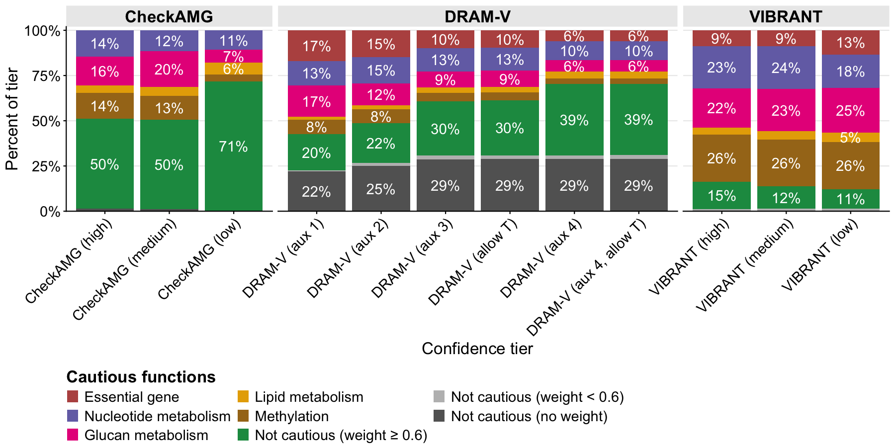<!-- -->

# Tier trade-offs

Each tool and tier is one point: its geNomad-viral share of calls on a
logit axis against three measures of what its calls are, with point area
giving the number of calls on a log scale. All three measures are shares
of the tier’s geNomad-viral calls, so the panels share one denominator
and none is bounded by the viral share on the x axis. The left panel is
the share with a Metabolism KO, from the shared KO classes of Figure 3A.
The middle panel is the share with an AMG weight of at least 0.6, the
two upper bins of Figure 3C. The right panel is the share that is not
cautious, the three ‘Not cautious’ categories of Figure 3D, where a
viral call with no annotation has no cautious assignment and counts as
not ‘not cautious’. Marker shape gives the tier, and the tiers are
cumulative: high, medium and low for CheckAMG and VIBRANT, and aux 1,
aux 2, aux 3 and aux 4 for DRAM-V, joined by solid lines. The DRAM-V
configurations that keep T-flagged genes, DRAM-V (allow T) and DRAM-V
(aux 4, allow T), are open squares joined by dashed lines to DRAM-V (aux
3) and DRAM-V (aux 4), which they contain and nearly coincide with.
CheckAMG tiers are defined from AMG weights, so its share in the middle
panel is high by construction.

``` r
tradeoff_sets <- c(fig3_tier_map[fig3_tool_sets$CheckAMG], fig3_tier_map[fig3_tool_sets$`DRAM-V`],
                   tier_pretty_map[c("DRAMV_allow_T", "DRAMV_aux_4", "DRAMV_aux_4_allow_T")], fig3_tier_map[fig3_tool_sets$VIBRANT])
tradeoff_levels <- c("high / aux 1", "medium / aux 2", "low / aux 3", "aux 4")

tradeoff_ko <- gene_calls %>%
  select(gene_key, all_of(names(tradeoff_sets))) %>%
  left_join(select(fig3_genes, gene_key, fill_primary), by = "gene_key") %>%
  pivot_longer(all_of(names(tradeoff_sets)), names_to = "set_code", values_to = "called") %>%
  filter(called) %>%
  group_by(set = unname(tradeoff_sets[set_code])) %>%
  summarise(n = n(), viral = sum(fill_primary != "Not geNomad viral"),
            metabolism = sum(fill_primary == "geNomad viral, Metabolism KO"), .groups = "drop")

# Every measure is a share of the tier's geNomad-viral calls, and a viral call with no annotation has no cautious assignment
tradeoff_function <- amg_weight_comp_sets %>%
  select(gene_key, tool, tier, `AMG weight bin`) %>%
  inner_join(select(to_ed_sets(amg_cautious_comp), gene_key, tool, tier, `Cautious functions`), by = c("gene_key", "tool", "tier")) %>%
  inner_join(select(filter(fig3_genes, fill_primary != "Not geNomad viral"), gene_key), by = "gene_key") %>%
  group_by(set = as.character(tier)) %>%
  summarise(n_viral_function = n(),
            n_viral_unannotated = sum(`AMG weight bin` == "No annotation"),
            weight_ge_0.6_among_viral = mean(`AMG weight bin` %in% c("AMG weight ≥ 0.8", "AMG weight 0.6 to 0.8")),
            not_cautious_among_viral = mean(startsWith(as.character(`Cautious functions`), "Not cautious") &
                                              `AMG weight bin` != "No annotation"))

tradeoff <- tradeoff_ko %>%
  left_join(tradeoff_function, by = "set") %>%
  mutate(tool = fig3_tool_of(set),
         tier = str_remove(str_remove(set, "^\\S+ \\("), "\\)$"),
         level = factor(case_when(tier %in% c("high", "aux 1") ~ "high / aux 1", tier %in% c("medium", "aux 2") ~ "medium / aux 2",
                                  tier %in% c("low", "aux 3", "allow T") ~ "low / aux 3", TRUE ~ "aux 4"), levels = tradeoff_levels),
         allow_T = str_detect(tier, "allow T"),
         viral_share = viral / n,
         metabolism_among_viral = metabolism / viral,
         label = paste0(tier, " (", scales::comma(n), ")")) %>%
  arrange(match(set, tradeoff_sets))
stopifnot(nrow(tradeoff) == 12, all(tradeoff$viral == tradeoff$n_viral_function))
tradeoff %>% select(set, n, viral, viral_share, metabolism_among_viral, weight_ge_0.6_among_viral, not_cautious_among_viral, n_viral_unannotated)
```

    ## # A tibble: 12 × 8
    ##    set         n viral viral_share metabolism_among_viral weight_ge_0.6_among_…¹
    ##    <chr>   <int> <int>       <dbl>                  <dbl>                  <dbl>
    ##  1 Check…   3221  3153      0.979                   0.555                  0.987
    ##  2 Check…   6728  5843      0.868                   0.595                  0.989
    ##  3 Check… 170161  8879      0.0522                  0.614                  0.991
    ##  4 DRAM-…   3380  3135      0.928                   0.522                  0.264
    ##  5 DRAM-…  13566  9490      0.700                   0.569                  0.240
    ##  6 DRAM-…  47308 16746      0.354                   0.612                  0.266
    ##  7 DRAM-…  52012 17049      0.328                   0.613                  0.264
    ##  8 DRAM-… 160941 21014      0.131                   0.612                  0.264
    ##  9 DRAM-… 171833 21352      0.124                   0.614                  0.262
    ## 10 VIBRA…   1270  1263      0.994                   0.919                  0.353
    ## 11 VIBRA…   3720  3708      0.997                   0.928                  0.329
    ## 12 VIBRA…  12677 12531      0.988                   0.926                  0.307
    ## # ℹ abbreviated name: ¹​weight_ge_0.6_among_viral
    ## # ℹ 2 more variables: not_cautious_among_viral <dbl>, n_viral_unannotated <int>

``` r
tradeoff_panels <- c("Metabolism KO share of viral calls",
                     "AMG weight ≥ 0.6 share of viral calls",
                     "Not cautious share of viral calls")
tradeoff_long <- tradeoff %>%
  pivot_longer(c(metabolism_among_viral, weight_ge_0.6_among_viral, not_cautious_among_viral), names_to = "measure", values_to = "y") %>%
  mutate(panel = factor(tradeoff_panels[match(measure, c("metabolism_among_viral", "weight_ge_0.6_among_viral", "not_cautious_among_viral"))],
                        levels = tradeoff_panels))
tradeoff_allow_T_steps <- bind_rows(
  tradeoff_long %>% filter(set %in% c("DRAM-V (aux 3)", "DRAM-V (allow T)")) %>% mutate(path = "aux 3"),
  tradeoff_long %>% filter(set %in% c("DRAM-V (aux 4)", "DRAM-V (aux 4, allow T)")) %>% mutate(path = "aux 4")
)
```

``` r
p_tier_tradeoffs <- ggplot(tradeoff_long, aes(viral_share, y)) +
  geom_path(data = filter(tradeoff_long, !allow_T), aes(group = tool, color = tool), linewidth = 0.6) +
  geom_path(data = tradeoff_allow_T_steps, aes(group = path, color = tool), linetype = "22", linewidth = 0.6) +
  # Open allow T squares around the nearly coincident aux 3 and aux 4 points keep both visible
  geom_point(aes(color = tool, shape = if_else(allow_T, "DRAM-V allow T", as.character(level)), size = n), stroke = 1.1, alpha = 0.9) +
  ggrepel::geom_text_repel(aes(label = label, color = tool, point.size = 2 * log10(n)), size = 3.5, seed = 3, box.padding = 0.5,
                           point.padding = 0.2, force = 3, min.segment.length = 0, segment.size = 0.3, max.overlaps = Inf,
                           show.legend = FALSE) +
  facet_wrap(~panel, nrow = 1) +
  scale_color_manual(values = tool_pal, name = "Tool") +
  scale_shape_manual(values = c("high / aux 1" = 16, "medium / aux 2" = 17, "low / aux 3" = 15, "aux 4" = 18, "DRAM-V allow T" = 0),
                     limits = c(tradeoff_levels, "DRAM-V allow T"), name = "Tier") +
  # Log-scaled sizes keep the 1,270-call and 171,833-call tiers both legible
  scale_size(trans = "log10", range = c(2, 9), limits = c(1e3, 2e5), breaks = c(1e3, 1e4, 1e5), labels = scales::comma,
             name = "Calls in tier") +
  guides(color = guide_legend(override.aes = list(shape = 16, size = 4), order = 1),
         shape = guide_legend(override.aes = list(color = "grey40", size = 4), order = 2),
         size = guide_legend(override.aes = list(shape = 16, color = "grey60"), order = 3)) +
  scale_x_continuous(trans = "logit", breaks = c(0.05, 0.25, 0.5, 0.75, 0.95, 0.99), labels = scales::percent,
                     limits = c(0.03, 0.998)) +
  scale_y_continuous(labels = scales::percent, limits = c(0, 1)) +
  labs(x = "geNomad-viral share of calls", y = "Share") +
  theme(axis.title = element_text(size = 14), axis.text = element_text(size = 12), strip.text = element_text(size = 14),
        legend.title = element_text(size = 14), legend.text = element_text(size = 12),
        legend.position = "bottom", legend.direction = "horizontal", legend.box = "vertical", legend.box.just = "left",
        panel.spacing.x = unit(1.2, "lines"))

save_plot_both(p_tier_tradeoffs, "amg_tier_tradeoffs", 13, 6.5, 300)
print(p_tier_tradeoffs)
```

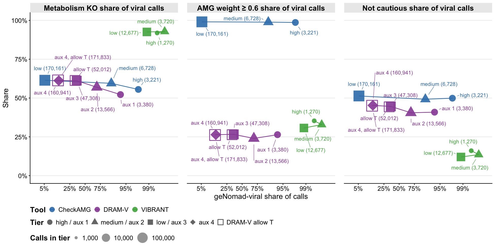<!-- -->

# AMG calls per tier

Tier totals count every gene called in each of the twelve Extended Data
sets, so a gene called at CheckAMG (high) is also counted at CheckAMG
(medium) and CheckAMG (low), and each DRAM-V call is counted once, in
its one DRAM-V set. The all-tier composition plots above count calls the
same way.

``` r
tier_call_totals <- amg_weight_comp_sets %>%
  group_by(tool, tier) %>%
  summarise(
    all_calls = n(),
    likely_amgs = sum(`Likely AMG` == "Likely AMG (weight ≥ 0.6)"),
    .groups = "drop"
  ) %>%
  pivot_longer(
    cols = c(all_calls, likely_amgs),
    names_to = "Call set",
    values_to = "AMG calls"
  )

tier_call_totals
```

    ## # A tibble: 24 × 4
    ##    tool     tier              `Call set`  `AMG calls`
    ##    <chr>    <fct>             <chr>             <int>
    ##  1 CheckAMG CheckAMG (high)   all_calls          3221
    ##  2 CheckAMG CheckAMG (high)   likely_amgs        3178
    ##  3 CheckAMG CheckAMG (medium) all_calls          6728
    ##  4 CheckAMG CheckAMG (medium) likely_amgs        6654
    ##  5 CheckAMG CheckAMG (low)    all_calls        170161
    ##  6 CheckAMG CheckAMG (low)    likely_amgs      169368
    ##  7 DRAM-V   DRAM-V (aux 1)    all_calls          3380
    ##  8 DRAM-V   DRAM-V (aux 1)    likely_amgs         915
    ##  9 DRAM-V   DRAM-V (aux 2)    all_calls         13566
    ## 10 DRAM-V   DRAM-V (aux 2)    likely_amgs        3949
    ## # ℹ 14 more rows

``` r
p_tier_call_totals <- ggplot(
  tier_call_totals %>%
    filter(`AMG calls` > 0),
  aes(
    x = tier,
    y = `AMG calls`,
    fill = `Call set`
  )
) +
  geom_col(
    position = position_dodge(width = 0.85),
    width = 0.8
  ) +
  geom_text(
    aes(label = scales::comma(`AMG calls`)),
    position = position_dodge(width = 0.85),
    angle = 90,
    hjust = -0.1,
    size = 4.5
  ) +
  facet_grid(
    . ~ tool,
    scales = "free_x",
    space = "free_x"
  ) +
  scale_fill_manual(
    values = c(
      "all_calls" = "#BDBDBD",
      "likely_amgs" = "#1A9850"
    ),
    labels = c(
      "all_calls" = "All calls",
      "likely_amgs" = "Likely AMGs (weight ≥ 0.6)"
    ),
    name = NULL
  ) +
  scale_y_log10(
    labels = scales::comma,
    expand = expansion(mult = c(0, 0.45))
  ) +
  labs(
    x = "Confidence tier",
    y = "AMG calls"
  ) +
  theme(
    legend.position = "bottom",
    legend.text = element_text(size = 14),
    axis.title.y = element_text(size = 16),
    axis.text.y = element_text(size = 14),
    axis.title.x = element_text(size = 16),
    axis.text.x = element_text(size = 14, angle = 45, hjust = 1),
    strip.text.x = element_text(size = 16)
  )

print(p_tier_call_totals)
```

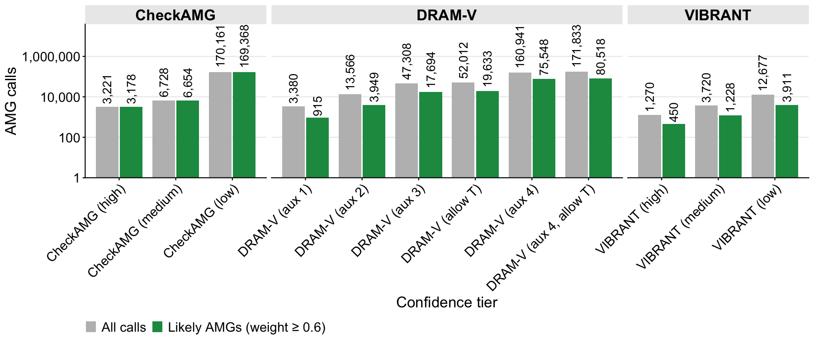<!-- -->

# Reference AMG sets

## Reference set sizes

``` r
reference_set_sizes <- bind_rows(
  reference_hmms %>%
    filter(`CheckAMG (all)`) %>%
    summarise(tool = "CheckAMG", `Reference set` = "All references", KO = sum(KEGG), Pfam = sum(Pfam)),
  reference_hmms %>%
    filter(`CheckAMG (AMG weight >= 0.6)`) %>%
    summarise(tool = "CheckAMG", `Reference set` = "AMG weight ≥ 0.6", KO = sum(KEGG), Pfam = sum(Pfam)),
  reference_hmms %>%
    filter(DRAMV) %>%
    summarise(tool = "DRAM-V", `Reference set` = "Curated AMG reference", KO = sum(KEGG), Pfam = sum(Pfam)),
  reference_hmms %>%
    filter(VIBRANT) %>%
    summarise(tool = "VIBRANT", `Reference set` = "Curated AMG reference", KO = sum(KEGG), Pfam = sum(Pfam))
) %>%
  pivot_longer(
    cols = c(KO, Pfam),
    names_to = "Entry type",
    values_to = "Reference entries"
  ) %>%
  mutate(
    tool = factor(tool, levels = c("CheckAMG", "DRAM-V", "VIBRANT")),
    `Reference set` = factor(
      `Reference set`,
      levels = c("All references", "AMG weight ≥ 0.6", "Curated AMG reference")
    )
  )

reference_set_sizes
```

    ## # A tibble: 8 × 4
    ##   tool     `Reference set`       `Entry type` `Reference entries`
    ##   <fct>    <fct>                 <chr>                      <int>
    ## 1 CheckAMG All references        KO                         10055
    ## 2 CheckAMG All references        Pfam                        1611
    ## 3 CheckAMG AMG weight ≥ 0.6      KO                          8633
    ## 4 CheckAMG AMG weight ≥ 0.6      Pfam                        1069
    ## 5 DRAM-V   Curated AMG reference KO                            34
    ## 6 DRAM-V   Curated AMG reference Pfam                         261
    ## 7 VIBRANT  Curated AMG reference KO                          2826
    ## 8 VIBRANT  Curated AMG reference Pfam                           0

``` r
p_reference_set_sizes <- ggplot(
  reference_set_sizes %>%
    filter(`Reference entries` > 0),
  aes(
    x = `Entry type`,
    y = `Reference entries`,
    fill = tool
  )
) +
  geom_col(width = 0.75) +
  geom_text(
    aes(label = scales::comma(`Reference entries`)),
    vjust = -0.3,
    size = 4.5
  ) +
  facet_grid(
    . ~ tool + `Reference set`,
    scales = "free_x",
    space = "free_x",
    labeller = labeller(`Reference set` = label_wrap_gen(12))
  ) +
  scale_fill_manual(
    values = tool_pal,
    guide = "none"
  ) +
  scale_y_log10(
    labels = scales::comma,
    expand = expansion(mult = c(0, 0.2))
  ) +
  labs(
    x = NULL,
    y = "Reference entries"
  ) +
  theme(
    axis.title.y = element_text(size = 16),
    axis.text.y = element_text(size = 14),
    axis.text.x = element_text(size = 14),
    strip.text.x = element_text(size = 12)
  )

print(p_reference_set_sizes)
```

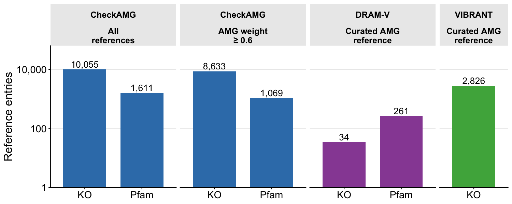<!-- -->

## Reference HMM overlap

Pfam, KEGG, and dbCAN profiles are colored by that database even when
METABOLIC or CAMPER also include them, so only profiles custom built by
METABOLIC or CAMPER carry those colors.

``` r
reference_upset_data <- reference_hmms %>%
  dplyr::rename(`CheckAMG (AMG weight ≥ 0.6)` = `CheckAMG (AMG weight >= 0.6)`) %>%
  mutate(
    n_databases = Pfam + KEGG + FOAM + METABOLIC + CAMPER + dbCAN,
    `Database source` = case_when(
      Pfam ~ "Pfam",
      KEGG ~ "KEGG",
      dbCAN ~ "dbCAN",
      n_databases == 0 ~ "None",
      n_databases > 1 ~ "Multiple DBs",
      FOAM ~ "FOAM",
      METABOLIC ~ "METABOLIC (custom)",
      CAMPER ~ "CAMPER (custom)"
    ),
    `Database source` = factor(`Database source`, levels = db_source_levels),
    `CheckAMG (AMG weight < 0.6)` = `CheckAMG (all)` & !`CheckAMG (AMG weight ≥ 0.6)`,
    `DRAM-V` = DRAMV
  )

stopifnot(all(reference_upset_data$Pfam + reference_upset_data$KEGG + reference_upset_data$dbCAN <= 1),
          !anyDuplicated(reference_upset_data$HMM))

reference_sets <- c(
  "CheckAMG (AMG weight ≥ 0.6)",
  "CheckAMG (AMG weight < 0.6)",
  "DRAM-V",
  "VIBRANT"
)

p_reference_upset <- ComplexUpset::upset(
  data = as.data.frame(reference_upset_data),
  intersect = rev(reference_sets),
  name = NULL,
  sort_sets = FALSE,
  sort_intersections = "descending",
  min_size = 1,
  height_ratio = 0.6,
  width_ratio = 0.3,
  guides = "over",

  base_annotations = list(
    "Reference HMMs" = ComplexUpset::intersection_size(
      mapping = aes(fill = `Database source`),
      text_mapping = aes(label = scales::comma(!!ComplexUpset::get_size_mode("exclusive_intersection"))),
      text = list(size = 4, angle = 90, vjust = 0.5, hjust = -0.1),
      text_colors = c(on_background = "black", on_bar = "black")
    ) +
      coord_trans(y = scales::pseudo_log_trans(base = 10)) +
      scale_y_continuous(
        breaks = c(0, 10, 100, 1000, 10000, 100000),
        labels = scales::comma,
        expand = expansion(mult = c(0, 0.25))
      ) +
      scale_fill_manual(
        values = db_source_pal,
        name = "Database source",
        drop = TRUE
      ) +
      theme(
        panel.grid = element_blank(),
        axis.title.y = element_text(size = 16),
        axis.text.y = element_text(size = 14),
        legend.title = element_text(size = 16),
        legend.text = element_text(size = 14),
        legend.margin = margin(0, 18, 0, 0)
      )
  ),

  matrix = ComplexUpset::intersection_matrix(
    geom = geom_point(size = 3),
    segment = geom_segment(linetype = "solid", color = "black"),
    outline_color = list(active = "grey60", inactive = "grey90")
  ),

  themes = ComplexUpset::upset_modify_themes(
    list(
      "intersections_matrix" = theme(
        axis.text.y = element_text(size = 14),
        axis.title.y = element_blank(),
        axis.title.x = element_blank()
      )
    )
  ),

  set_sizes = ComplexUpset::upset_set_size(position = "right") +
    geom_text(
      aes(label = scales::comma(after_stat(count))),
      stat = "count",
      hjust = -0.1,
      size = 4
    ) +
    scale_y_continuous(
      labels = scales::comma,
      breaks = function(lim) Filter(function(b) b <= 0.8 * lim[2], scales::breaks_extended(3)(lim)),
      expand = expansion(mult = c(0, 0.6))
    ) +
    labs(y = "Reference HMMs per set") +
    theme(
      axis.text.x = element_text(size = 12),
      axis.title.x = element_text(size = 14)
    )
) & theme(legend.margin = margin(0, 18, 0, 0))

print(p_reference_upset)
```

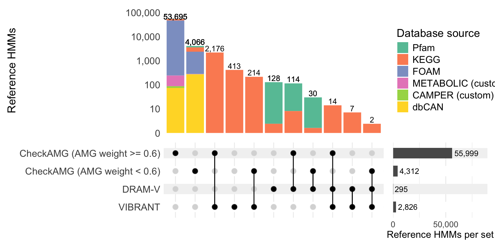<!-- -->

# Reasons for non-overlapping calls

Each default/high call is classified by what each other tool did with
the same gene, using the precedence order in `classify_nonoverlap` in
`amg_benchmark_comparisons.ipynb`. DRAM-V (default) calls are classified
per gene on the `gene_id` of their `amg_summary.tsv` rows and are shown
as the cumulative auxiliary-score sets DRAM-V (aux 1), (aux 2) and (aux
3), with the categories and the legend unchanged. The check below
confirms that the DRAM-V (aux 3) facet equals the pooled DRAM-V
(default) facet in every category. Each facet title names the tool, the
tier and the number of calls. The strip under the titles shows the share
of the facet’s calls off a geNomad-viral region with its count and
percent, and the row below it gives the calls with no viral evidence (no
geNomad viral region, no CheckAMG strict viral region, and no viral gene
on either flank). For DRAM-V, “Called only at lower stringency” means
the gene carried DRAM-V’s metabolism (M) flag and passed only a relaxed
auxiliary-score or T-flag configuration. It does not mean DRAM-V found
viral support or annotated the same function.

``` r
nonoverlap_source_tiers <- c("CheckAMG_high", "DRAMV_aux1", "DRAMV_aux2", "DRAMV_aux3", "VIBRANT_high")
nonoverlap_tier_label <- c("CheckAMG_high" = "CheckAMG (high)", "DRAMV_aux1" = "DRAM-V (aux 1)", "DRAMV_aux2" = "DRAM-V (aux 2)",
                           "DRAMV_aux3" = "DRAM-V (aux 3)", "VIBRANT_high" = "VIBRANT (high)")
nonoverlap_key <- c("gene", "sample", "source", "ecosystem")

# The classification does not depend on the auxiliary score, so pooled rows are copied to each cumulative set they belong to
nonoverlap_calls_split <- nonoverlap_calls %>%
  left_join(gene_calls %>% select(all_of(nonoverlap_key), DRAMV_default, DRAMV_auxiliary_score), by = nonoverlap_key) %>%
  tidyr::uncount(if_else(source_tier == "DRAMV_default", 4L - as.integer(DRAMV_auxiliary_score), 1L), .id = "aux_copy") %>%
  mutate(source_tier = if_else(source_tier == "DRAMV_default",
                               paste0("DRAMV_aux", as.integer(DRAMV_auxiliary_score) + aux_copy - 1L), source_tier)) %>%
  select(-aux_copy)
stopifnot(sum(!startsWith(nonoverlap_calls_split$source_tier, "DRAMV_aux")) == sum(nonoverlap_calls$source_tier != "DRAMV_default"),
          sum(nonoverlap_calls_split$source_tier == "DRAMV_aux3") == sum(nonoverlap_calls$source_tier == "DRAMV_default"),
          all(nonoverlap_calls_split$source_tier %in% nonoverlap_source_tiers),
          all(nonoverlap_calls_split$DRAMV_default[startsWith(nonoverlap_calls_split$source_tier, "DRAMV_aux")]))

nonoverlap_summary <- nonoverlap_calls_split %>%
  count(source_tier, other_tool, category) %>%
  group_by(source_tier, other_tool) %>%
  mutate(pct = n / sum(n)) %>%
  ungroup() %>%
  mutate(
    Classification = factor(
      recode(category, !!!nonoverlap_category_map),
      levels = nonoverlap_category_levels
    ),
    `Other tool` = factor(
      recode(other_tool, !!!tool_pretty_map),
      levels = c("CheckAMG", "DRAM-V", "VIBRANT")
    ),
    source_tier = factor(source_tier, levels = nonoverlap_source_tiers)
  )

nonoverlap_summary
```

    ## # A tibble: 57 × 7
    ##    source_tier   other_tool category       n     pct Classification `Other tool`
    ##    <fct>         <chr>      <chr>      <int>   <dbl> <fct>          <fct>       
    ##  1 CheckAMG_high DRAMV      a. other …   204 6.33e-2 Called only a… DRAM-V      
    ##  2 CheckAMG_high DRAMV      agrees at…  1332 4.14e-1 Agrees at def… DRAM-V      
    ##  3 CheckAMG_high DRAMV      c. source…   130 4.04e-2 Best-hit data… DRAM-V      
    ##  4 CheckAMG_high DRAMV      d. same d…  1531 4.75e-1 Shared-databa… DRAM-V      
    ##  5 CheckAMG_high DRAMV      e. other …    22 6.83e-3 Different top… DRAM-V      
    ##  6 CheckAMG_high DRAMV      f. other …     2 6.21e-4 No annotation… DRAM-V      
    ##  7 CheckAMG_high VIBRANT    a. other …  1053 3.27e-1 Called only a… VIBRANT     
    ##  8 CheckAMG_high VIBRANT    agrees at…   221 6.86e-2 Agrees at def… VIBRANT     
    ##  9 CheckAMG_high VIBRANT    c. source…   119 3.69e-2 Best-hit data… VIBRANT     
    ## 10 CheckAMG_high VIBRANT    d. same d…  1578 4.90e-1 Shared-databa… VIBRANT     
    ## # ℹ 47 more rows

``` r
facet_counts <- function(calls) {
  calls %>%
    distinct(gene, sample, source, ecosystem, source_tier, likely_false_positive, genomad_viral) %>%
    group_by(source_tier) %>%
    summarise(
      n_calls = n(),
      n_without_viral_evidence = sum(likely_false_positive),
      n_not_genomad_viral = sum(!genomad_viral),
      .groups = "drop"
    )
}
source_tier_facet_labels <- facet_counts(nonoverlap_calls_split) %>%
  mutate(
    pct_not_genomad_viral = n_not_genomad_viral / n_calls,
    source_tier = factor(source_tier, levels = nonoverlap_source_tiers),
    facet_label = paste0(recode(as.character(source_tier), !!!nonoverlap_tier_label), "\nn = ", scales::comma(n_calls))
  ) %>%
  arrange(source_tier)

# Every count of the aux 3 facet must equal the pooled DRAM-V (default) facet
aux_tiers <- "DRAMV_aux3"
pooled_facet <- facet_counts(filter(nonoverlap_calls, source_tier == "DRAMV_default"))
split_facet <- source_tier_facet_labels %>% filter(source_tier %in% aux_tiers) %>%
  summarise(across(c(n_calls, n_without_viral_evidence, n_not_genomad_viral), sum))
stopifnot(all(unlist(split_facet) == unlist(pooled_facet[c("n_calls", "n_without_viral_evidence", "n_not_genomad_viral")])))
pooled_reasons <- nonoverlap_calls %>% filter(source_tier == "DRAMV_default") %>% count(other_tool, category, name = "n_pooled") %>%
  full_join(nonoverlap_summary %>% filter(source_tier %in% aux_tiers) %>% group_by(other_tool, category) %>%
              summarise(n_split = sum(n), .groups = "drop"), by = c("other_tool", "category"))
stopifnot(all(pooled_reasons$n_pooled == pooled_reasons$n_split))

source_tier_facet_labels
```

    ## # A tibble: 5 × 6
    ##   source_tier   n_calls n_without_viral_evidence n_not_genomad_viral
    ##   <fct>           <int>                    <int>               <int>
    ## 1 CheckAMG_high    3221                        1                  68
    ## 2 DRAMV_aux1       3380                        0                 245
    ## 3 DRAMV_aux2      13566                        5                4076
    ## 4 DRAMV_aux3      47308                      222               30562
    ## 5 VIBRANT_high     1270                        0                   7
    ## # ℹ 2 more variables: pct_not_genomad_viral <dbl>, facet_label <chr>

``` r
p_nonoverlap <- ggplot(
  nonoverlap_summary,
  aes(
    x = `Other tool`,
    y = pct,
    fill = Classification
  )
) +
  geom_col(width = 0.75) +
  geom_text(
    aes(label = ifelse(pct >= 0.05, paste0(round(100 * pct, 0), "%"), "")),
    position = position_stack(vjust = 0.5),
    size = 5,
    color = "white"
  ) +
  facet_wrap(
    ~ source_tier,
    nrow = 1,
    scales = "free_x",
    labeller = labeller(
      source_tier = setNames(
        source_tier_facet_labels$facet_label,
        source_tier_facet_labels$source_tier
      )
    )
  ) +
  scale_fill_manual(
    values = nonoverlap_category_pal,
    name = "Classification",
    labels = function(x) str_wrap(x, 30),
    drop = TRUE
  ) +
  scale_y_continuous(
    labels = label_percent(scale = 100),
    expand = expansion(mult = c(0, 0.02))
  ) +
  labs(
    x = "Other tool",
    y = "Percent of source tier calls"
  ) +
  theme(
    legend.position = "bottom",
    legend.justification = "left",
    legend.location = "plot",
    legend.title = element_text(size = 14),
    legend.text = element_text(size = 12),
    legend.key.size = unit(0.9, "lines"),
    legend.key.spacing.y = unit(0.25, "lines"),
    legend.key.spacing.x = unit(1.2, "lines"),
    axis.title = element_text(size = 14),
    axis.text = element_text(size = 12),
    strip.text.x = element_text(size = 12)
  ) +
  guides(
    fill = guide_legend(
      nrow = 2,
      title.position = "top"
    )
  )

strip_rows <- c("Not geNomad viral", "No viral evidence")
nonoverlap_strip <- source_tier_facet_labels %>%
  mutate(bar_label = paste0(scales::comma(n_not_genomad_viral), " (", sprintf("%.1f", 100 * pct_not_genomad_viral), "%)"),
         inside = pct_not_genomad_viral >= 0.6,
         row_not_viral = factor("Not geNomad viral", levels = rev(strip_rows)),
         row_no_evidence = factor("No viral evidence", levels = rev(strip_rows)))
p_nonoverlap_strip <- ggplot(nonoverlap_strip) +
  geom_col(aes(x = 1, y = row_not_viral), fill = "grey92", width = 0.7) +
  geom_col(aes(x = pct_not_genomad_viral, y = row_not_viral), fill = "#636363", width = 0.7) +
  geom_text(aes(x = ifelse(inside, pct_not_genomad_viral - 0.02, pct_not_genomad_viral + 0.02), y = row_not_viral,
                label = bar_label, hjust = ifelse(inside, 1, 0), color = inside), size = 4) +
  geom_text(aes(x = 0, y = row_no_evidence, label = scales::comma(n_without_viral_evidence)), hjust = 0, size = 4) +
  scale_color_manual(values = c(`TRUE` = "white", `FALSE` = "black"), guide = "none") +
  scale_x_continuous(limits = c(0, 1), expand = expansion(mult = c(0, 0.01))) +
  scale_y_discrete(drop = FALSE) +
  facet_wrap(~ source_tier, nrow = 1, labeller = labeller(source_tier = setNames(source_tier_facet_labels$facet_label,
                                                                                 as.character(source_tier_facet_labels$source_tier)))) +
  labs(x = NULL, y = NULL) +
  theme(panel.grid.major.y = element_blank(), axis.ticks = element_blank(), axis.line = element_blank(), axis.text.x = element_blank(),
        axis.text.y = element_text(size = 12), strip.text.x = element_text(size = 12), plot.margin = margin(2, 5.5, 0, 5.5))
p_nonoverlap <- p_nonoverlap_strip /
  (p_nonoverlap + theme(strip.text.x = element_blank(), strip.background = element_blank())) +
  plot_layout(heights = c(0.16, 1))

print(p_nonoverlap)
```

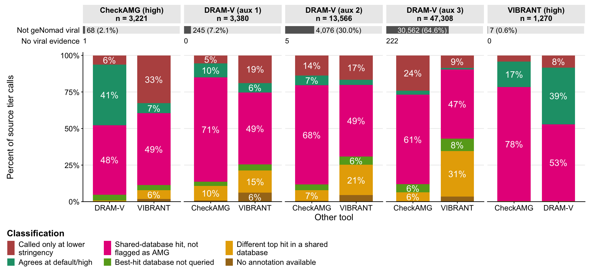<!-- -->

# Independent viral evidence in tier-conflict scenarios

Scenario definitions and context flags follow `CONFLICT_SCENARIOS` and
`context_flags` in `amg_benchmark_comparisons.ipynb`. DRAM-V (default)
vs CheckAMG (low) holds genes called by DRAM-V (default) and CheckAMG
(low) but not CheckAMG (high), and DRAM-V (default) vs VIBRANT (low)
holds genes called by DRAM-V (default) and VIBRANT (low) but not VIBRANT
(high). A nearby viral gene means a gene with V-score at least 10 within
10 kb. The MGE flags use the nearest MGE-annotated gene on each side,
with no distance limit, and a gene can carry both flags when its two
sides differ.

``` r
context_distance_max_bp <- 10000
viral_v_score_min <- 10

context_signals <- c(
  "geNomad viral region",
  "CheckAMG strict viral region",
  "Viral gene within 10 kb (at least one side)",
  "Viral gene within 10 kb (both sides)",
  "Virus-like MGE flank",
  "Bacteria-like MGE flank"
)

gene_context <- gene_calls %>%
  mutate(
    viral_gene_left_near = !is.na(viral_gene_left_dist) & viral_gene_left_dist <= context_distance_max_bp,
    viral_gene_right_near = !is.na(viral_gene_right_dist) & viral_gene_right_dist <= context_distance_max_bp,
    `geNomad viral region` = genomad_viral,
    `CheckAMG strict viral region` = in_strict_viral_region,
    `Viral gene within 10 kb (at least one side)` = viral_gene_left_near | viral_gene_right_near,
    `Viral gene within 10 kb (both sides)` = viral_gene_left_near & viral_gene_right_near,
    `Virus-like MGE flank` =
      (!is.na(MGE_gene_left_V_score) & MGE_gene_left_V_score >= viral_v_score_min) |
      (!is.na(MGE_gene_right_V_score) & MGE_gene_right_V_score >= viral_v_score_min),
    `Bacteria-like MGE flank` =
      (!is.na(MGE_gene_left_V_score) & MGE_gene_left_V_score < viral_v_score_min) |
      (!is.na(MGE_gene_right_V_score) & MGE_gene_right_V_score < viral_v_score_min)
  )

conflict_scenario_levels <- c(
  "CheckAMG (high) vs DRAM-V (allow T)",
  "CheckAMG (high) vs DRAM-V (aux 4)",
  "CheckAMG (high) vs DRAM-V (aux 4, allow T)",
  "VIBRANT (high) vs DRAM-V (allow T)",
  "VIBRANT (high) vs DRAM-V (aux 4, allow T)",
  "DRAM-V (default) vs CheckAMG (low)",
  "DRAM-V (default) vs VIBRANT (low)",
  "CheckAMG (high) vs VIBRANT (low)",
  "VIBRANT (high) vs CheckAMG (low)"
)

conflict_scenario_genes <- bind_rows(
  gene_context %>%
    filter(CheckAMG_high, DRAMV_allow_T, !DRAMV_default) %>%
    mutate(Scenario = "CheckAMG (high) vs DRAM-V (allow T)"),
  gene_context %>%
    filter(CheckAMG_high, DRAMV_aux_4, !DRAMV_default) %>%
    mutate(Scenario = "CheckAMG (high) vs DRAM-V (aux 4)"),
  gene_context %>%
    filter(CheckAMG_high, DRAMV_aux_4_allow_T, !DRAMV_default, !DRAMV_allow_T, !DRAMV_aux_4) %>%
    mutate(Scenario = "CheckAMG (high) vs DRAM-V (aux 4, allow T)"),
  gene_context %>%
    filter(VIBRANT_high, DRAMV_allow_T, !DRAMV_default) %>%
    mutate(Scenario = "VIBRANT (high) vs DRAM-V (allow T)"),
  gene_context %>%
    filter(VIBRANT_high, DRAMV_aux_4_allow_T, !DRAMV_default, !DRAMV_allow_T, !DRAMV_aux_4) %>%
    mutate(Scenario = "VIBRANT (high) vs DRAM-V (aux 4, allow T)"),
  gene_context %>%
    filter(DRAMV_default, CheckAMG_low, !CheckAMG_high) %>%
    mutate(Scenario = "DRAM-V (default) vs CheckAMG (low)"),
  gene_context %>%
    filter(DRAMV_default, VIBRANT_low, !VIBRANT_high) %>%
    mutate(Scenario = "DRAM-V (default) vs VIBRANT (low)"),
  gene_context %>%
    filter(CheckAMG_high, VIBRANT_low, !VIBRANT_high) %>%
    mutate(Scenario = "CheckAMG (high) vs VIBRANT (low)"),
  gene_context %>%
    filter(VIBRANT_high, CheckAMG_low, !CheckAMG_high) %>%
    mutate(Scenario = "VIBRANT (high) vs CheckAMG (low)")
)

tier_conflict_context <- conflict_scenario_genes %>%
  select(Scenario, all_of(context_signals)) %>%
  pivot_longer(
    cols = all_of(context_signals),
    names_to = "Context signal",
    values_to = "signal_present"
  ) %>%
  group_by(Scenario, `Context signal`) %>%
  summarise(
    n_genes = n(),
    n_with_signal = sum(signal_present),
    pct = n_with_signal / n_genes,
    .groups = "drop"
  ) %>%
  mutate(
    Scenario = factor(Scenario, levels = conflict_scenario_levels),
    `Context signal` = factor(`Context signal`, levels = context_signals)
  )

tier_conflict_context %>%
  select(Scenario, `Context signal`, n_genes, n_with_signal) %>%
  pivot_wider(names_from = `Context signal`, values_from = n_with_signal)
```

    ## # A tibble: 8 × 8
    ##   Scenario                 n_genes Bacteria-like MGE fl…¹ CheckAMG strict vira…²
    ##   <fct>                      <int>                  <int>                  <int>
    ## 1 CheckAMG (high) vs DRAM…      23                      2                     21
    ## 2 CheckAMG (high) vs DRAM…     181                      0                    156
    ## 3 CheckAMG (high) vs VIBR…    1053                     10                    958
    ## 4 DRAM-V (default) vs Che…   11390                    246                   2492
    ## 5 DRAM-V (default) vs VIB…    4071                     21                   3575
    ## 6 VIBRANT (high) vs Check…      54                      0                     30
    ## 7 VIBRANT (high) vs DRAM-…      24                      1                     21
    ## 8 VIBRANT (high) vs DRAM-…       1                      0                      1
    ## # ℹ abbreviated names: ¹​`Bacteria-like MGE flank`,
    ## #   ²​`CheckAMG strict viral region`
    ## # ℹ 4 more variables: `Viral gene within 10 kb (at least one side)` <int>,
    ## #   `Viral gene within 10 kb (both sides)` <int>, `Virus-like MGE flank` <int>,
    ## #   `geNomad viral region` <int>

``` r
scenario_facet_labels <- tier_conflict_context %>%
  distinct(Scenario, n_genes) %>%
  mutate(facet_label = paste0(Scenario, "\nn = ", scales::comma(n_genes)))

p_tier_conflict <- ggplot(
  tier_conflict_context,
  aes(
    x = `Context signal`,
    y = pct,
    fill = `Context signal`
  )
) +
  geom_col(width = 0.75) +
  geom_text(
    aes(label = paste0(round(100 * pct, 0), "%")),
    vjust = -0.3,
    size = 4
  ) +
  facet_wrap(
    ~ Scenario,
    ncol = 3,
    labeller = labeller(
      Scenario = setNames(
        scenario_facet_labels$facet_label,
        as.character(scenario_facet_labels$Scenario)
      )
    )
  ) +
  scale_fill_brewer(
    palette = "Set2",
    guide = "none"
  ) +
  scale_y_continuous(
    limits = c(0, 1.15),
    breaks = c(0, 0.25, 0.5, 0.75, 1),
    labels = label_percent(scale = 100)
  ) +
  labs(
    x = NULL,
    y = "Percent of genes in scenario"
  ) +
  theme(
    axis.title.y = element_text(size = 16),
    axis.text.y = element_text(size = 12),
    axis.text.x = element_text(size = 12, angle = 30, hjust = 1),
    strip.text.x = element_text(size = 12),
    plot.margin = margin(t = 6, r = 6, b = 6, l = 24)
  )

print(p_tier_conflict)
```

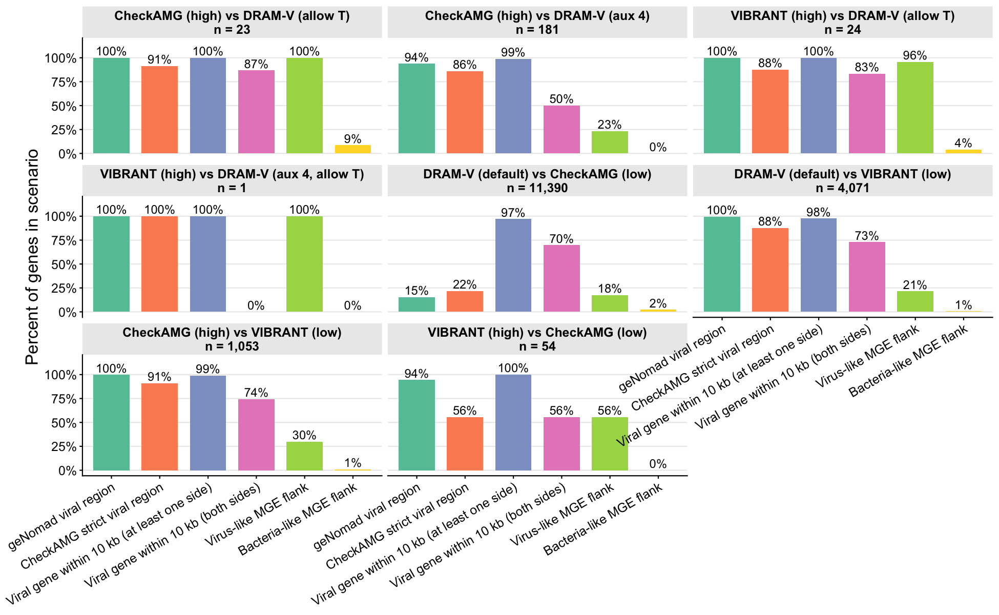<!-- -->

# geNomad-viral share per tool and tier

The share of each tier’s calls on regions geNomad calls viral, and of
DRAM-V (default) calls by DRAM-V auxiliary score and by the VirSorter2
`max_score` of their scaffold. Each bar is labeled with its share, and
the number of calls is printed under each tier label.

``` r
share_panels <- c("All calls per tier", "DRAM-V\n(default) by\nauxiliary score", "DRAM-V\n(default) by\nVirSorter2\nmax_score")

genomad_share_plot <- bind_rows(
  genomad_share_by_tier %>%
    transmute(panel = share_panels[1], tool, level = recode(tier, !!!tier_pretty_map), n_calls, genomad_viral_share),
  dramv_viral_support_split %>%
    transmute(
      panel = recode(split, "DRAM-V auxiliary score" = share_panels[2], "VirSorter2 max_score" = share_panels[3]),
      tool = "DRAM-V", level, n_calls, genomad_viral_share
    )
) %>%
  mutate(
    panel = factor(panel, levels = share_panels),
    level = factor(level, levels = c(tier_order_pretty, "1", "2", "3", "below 0.7", "0.7 to 0.9", "at least 0.9", "missing")),
    level_label = paste0(level, " (n = ", scales::comma(n_calls), ")")
  )

stopifnot(!any(is.na(genomad_share_plot$level)), !any(is.na(genomad_share_plot$panel)),
          !any(duplicated(as.character(genomad_share_plot$level))))

genomad_share_plot
```

    ## # A tibble: 16 × 6
    ##    panel                     tool  level n_calls genomad_viral_share level_label
    ##    <fct>                     <chr> <fct>   <dbl>               <dbl> <chr>      
    ##  1 "All calls per tier"      Chec… Chec…    3221              0.979  CheckAMG (…
    ##  2 "All calls per tier"      Chec… Chec…  170161              0.0522 CheckAMG (…
    ##  3 "All calls per tier"      Chec… Chec…    6728              0.868  CheckAMG (…
    ##  4 "All calls per tier"      DRAM… DRAM…   52012              0.328  DRAM-V (al…
    ##  5 "All calls per tier"      DRAM… DRAM…  160941              0.131  DRAM-V (au…
    ##  6 "All calls per tier"      DRAM… DRAM…  171833              0.124  DRAM-V (au…
    ##  7 "All calls per tier"      DRAM… DRAM…   47308              0.354  DRAM-V (de…
    ##  8 "All calls per tier"      VIBR… VIBR…    1270              0.994  VIBRANT (h…
    ##  9 "All calls per tier"      VIBR… VIBR…   12677              0.988  VIBRANT (l…
    ## 10 "All calls per tier"      VIBR… VIBR…    3720              0.997  VIBRANT (m…
    ## 11 "DRAM-V\n(default) by\na… DRAM… 1        3380              0.928  1 (n = 3,3…
    ## 12 "DRAM-V\n(default) by\na… DRAM… 2       10186              0.624  2 (n = 10,…
    ## 13 "DRAM-V\n(default) by\na… DRAM… 3       33742              0.215  3 (n = 33,…
    ## 14 "DRAM-V\n(default) by\nV… DRAM… 0.7 …    2966              0.870  0.7 to 0.9…
    ## 15 "DRAM-V\n(default) by\nV… DRAM… at l…   13039              0.989  at least 0…
    ## 16 "DRAM-V\n(default) by\nV… DRAM… belo…   31303              0.0405 below 0.7 …

``` r
level_labels <- setNames(genomad_share_plot$level_label, as.character(genomad_share_plot$level))
p_genomad_share <- ggplot(genomad_share_plot, aes(x = level, y = genomad_viral_share, fill = tool)) +
  geom_col(width = 0.75) +
  geom_text(aes(label = paste0(round(100 * genomad_viral_share, 0), "%")), vjust = -0.3, size = 3) +
  facet_grid(. ~ panel, scales = "free_x", space = "free_x") +
  scale_x_discrete(labels = function(x) level_labels[x]) +
  scale_fill_manual(values = tool_pal, guide = "none") +
  scale_y_continuous(limits = c(0, 1.1), breaks = c(0, 0.25, 0.5, 0.75, 1), labels = label_percent(scale = 100),
                     expand = expansion(mult = c(0, 0))) +
  coord_cartesian(clip = "off") +
  labs(x = NULL, y = "geNomad-viral share of calls") +
  theme(
    axis.title.y = element_text(size = 12),
    axis.text.y = element_text(size = 12),
    axis.text.x = element_text(size = 10, angle = 55, hjust = 1),
    strip.text.x = element_text(size = 10, lineheight = 0.9),
    strip.clip = "off",
    panel.spacing.x = unit(0.4, "lines"),
    plot.margin = margin(t = 8, r = 4, b = 4, l = 22)
  )

print(p_genomad_share)
```

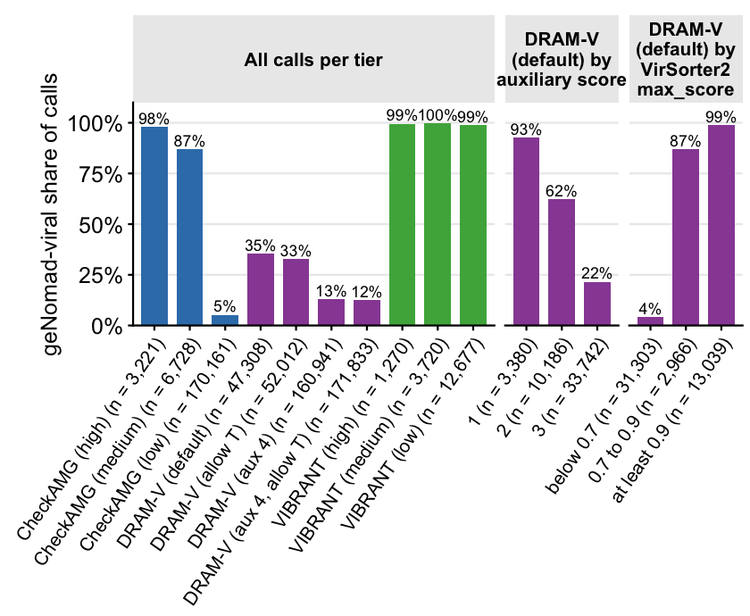<!-- -->

# Curation steps of DRAM-V (default) and CheckAMG (high)

The calls of DRAM-V (default) and CheckAMG (high) that remain after
successive steps that use only independent information or DRAM’s own,
counted above from `AMG_predictions_gene_level.parquet`: all calls,
calls on regions geNomad calls viral, and, for DRAM-V (default), the
geNomad-viral calls that also carry a DRAM distillate category, a
non-empty `sheet` in DRAM-V’s own `amg_summary.tsv` rows for the gene.
DRAM’s `verified` flag is not used. Bars are labeled with the calls
remaining.

``` r
curation_step_label <- c(
  "all_calls" = "All calls",
  "genomad_viral" = "geNomad viral",
  "genomad_viral_with_dram_category" = "With DRAM category"
)

curation_plot <- curation_steps %>%
  mutate(
    tool = recode(tier, "DRAMV_default" = "DRAM-V", "CheckAMG_high" = "CheckAMG"),
    Tier = factor(recode(tier, !!!tier_pretty_map), levels = c("DRAM-V (default)", "CheckAMG (high)")),
    Step = factor(recode(step, !!!curation_step_label), levels = unname(curation_step_label))
  )
stopifnot(!any(is.na(curation_plot$Tier)), !any(is.na(curation_plot$Step)))

curation_plot
```

    ## # A tibble: 5 × 8
    ##   tier          step_order step     n_calls share_of_all_calls tool  Tier  Step 
    ##   <chr>              <int> <chr>      <int>              <dbl> <chr> <fct> <fct>
    ## 1 DRAMV_default          1 all_cal…   47308             1      DRAM… DRAM… All …
    ## 2 DRAMV_default          2 genomad…   16746             0.354  DRAM… DRAM… geNo…
    ## 3 DRAMV_default          3 genomad…    4187             0.0885 DRAM… DRAM… With…
    ## 4 CheckAMG_high          1 all_cal…    3221             1      Chec… Chec… All …
    ## 5 CheckAMG_high          2 genomad…    3153             0.979  Chec… Chec… geNo…

``` r
p_curation_steps <- ggplot(curation_plot, aes(x = Step, y = n_calls, fill = tool)) +
  geom_col(width = 0.75) +
  geom_text(aes(label = scales::comma(n_calls)), angle = 90, hjust = -0.1, size = 2.7) +
  facet_grid(. ~ Tier, scales = "free_x", space = "free_x", labeller = labeller(Tier = label_wrap_gen(9))) +
  scale_x_discrete(labels = function(x) str_wrap(x, 10)) +
  scale_fill_manual(values = tool_pal, guide = "none") +
  scale_y_continuous(labels = scales::label_comma(scale = 1e-3, suffix = "k"), expand = expansion(mult = c(0, 0.3))) +
  labs(x = NULL, y = "Calls remaining") +
  theme(
    axis.title.y = element_text(size = 12),
    axis.text.y = element_text(size = 10),
    axis.text.x = element_text(size = 7.5, angle = 55, hjust = 1, lineheight = 0.85),
    strip.text.x = element_text(size = 7.5, lineheight = 0.9),
    strip.clip = "off",
    panel.spacing.x = unit(0.3, "lines"),
    plot.margin = margin(t = 8, r = 8, b = 4, l = 2)
  )

print(p_curation_steps)
```

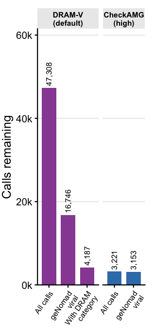<!-- -->

# Figure 3 composite

The layout: the all-tier UpSet by shared KO class (A), the per-tool
UpSets of each tool’s primary-tier calls (B), then the AMG weight (C),
cautious function (D) and database source (E) composition of CheckAMG
(high), DRAM-V (aux 1) and VIBRANT (high). The geNomad-viral share per
tier and the curation steps are not figure panels, and their counts are
cited from the table `level_grid_measures` of
`amg_benchmark_comparisons.ipynb` and from the curation steps counted
above.

``` r
fig3_height <- 14.5
p_fig3_bottom <- cowplot::plot_grid(
  p_weight_composition,
  # The two-column cautious legend is wider than its panel, so it starts under the narrow weight legend
  p_category_composition + theme(legend.box.margin = margin(l = -45)),
  p_db_composition,
  ncol = 3, rel_widths = c(1, 1, 1), align = "h", axis = "tb",
  labels = c("C", "D", "E"), label_size = 18
)
p_upset_comp_composite <- cowplot::plot_grid(
  p_fig3_upset_all,
  p_fig3_upset_per_tool,
  p_fig3_bottom,
  nrow = 3,
  rel_heights = c(5.2, 4, 4.8),
  labels = c("A", "B", ""),
  label_size = 18
)

save_plot_both(p_upset_comp_composite, "amg_comparisons_composite", 12, fig3_height, 300)
print(p_upset_comp_composite)
```

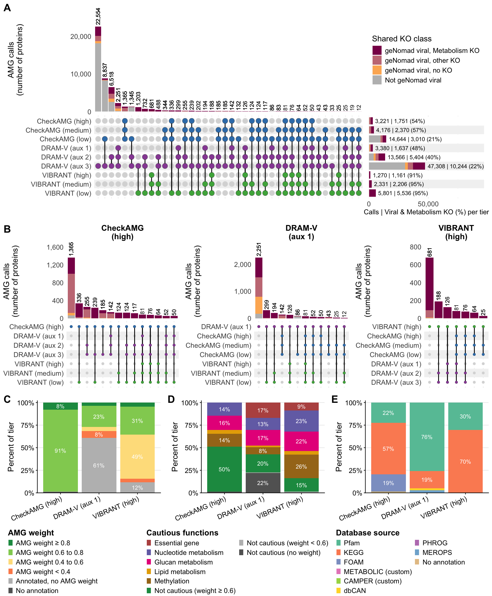<!-- -->

# Extended Data composites

Composite file names describe content rather than figure numbers,
because Extended Data numbering is set during renumbering.

## All-tier totals and composition

``` r
p_all_tiers_composite <- cowplot::plot_grid(
  p_tier_call_totals,
  p_weight_composition_all_tiers,
  p_category_composition_all_tiers,
  ncol = 1,
  rel_heights = c(1, 1.2, 1.2),
  labels = c("A", "B", "C"),
  label_size = 20
)

save_plot_both(p_all_tiers_composite, "amg_all_tiers_composite", 12, 18, 300)
print(p_all_tiers_composite)
```

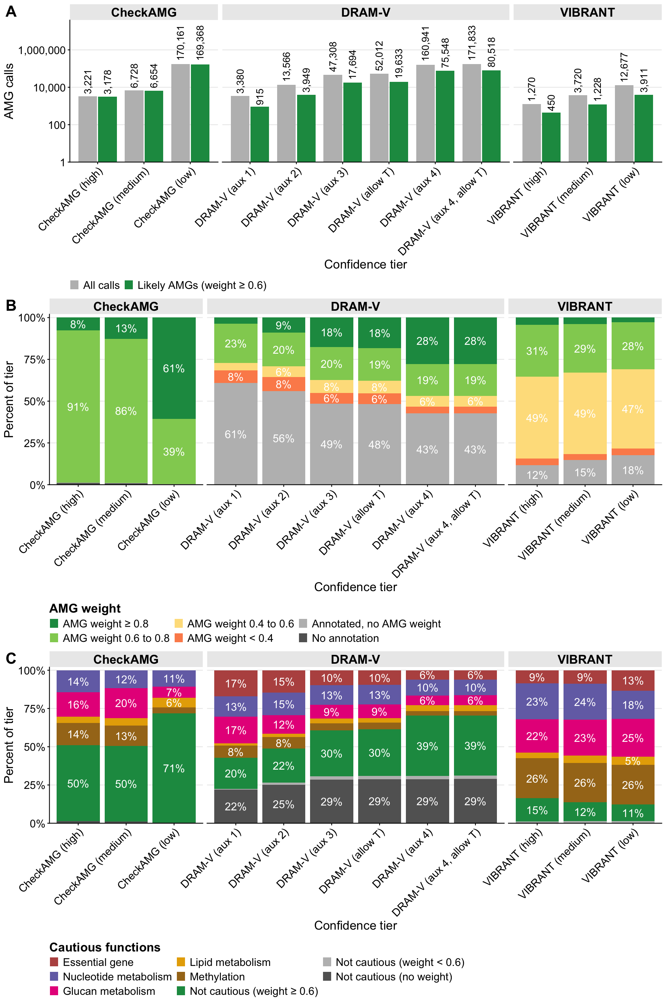<!-- -->

## Reference AMG sets

``` r
p_reference_sets_composite <- cowplot::plot_grid(
  p_reference_set_sizes,
  p_reference_upset,
  p_db_composition_all_tiers,
  ncol = 1,
  rel_heights = c(0.8, 1.1, 1),
  labels = c("A", "B", "C"),
  label_size = 20
)

save_plot_both(p_reference_sets_composite, "amg_reference_sets_composite", 12, 16, 300)
print(p_reference_sets_composite)
```

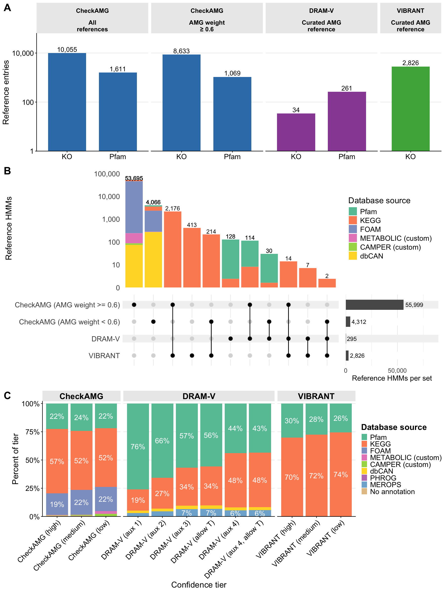<!-- -->

## Non-overlapping calls and viral evidence

``` r
p_nonoverlap_composite <- cowplot::plot_grid(
  p_nonoverlap,
  p_tier_conflict,
  ncol = 1,
  rel_heights = c(1.15, 1.5),
  labels = c("A", "B"),
  label_size = 20
)

save_plot_both(p_nonoverlap_composite, "amg_nonoverlap_composite", 13, 15, 300)
print(p_nonoverlap_composite)
```

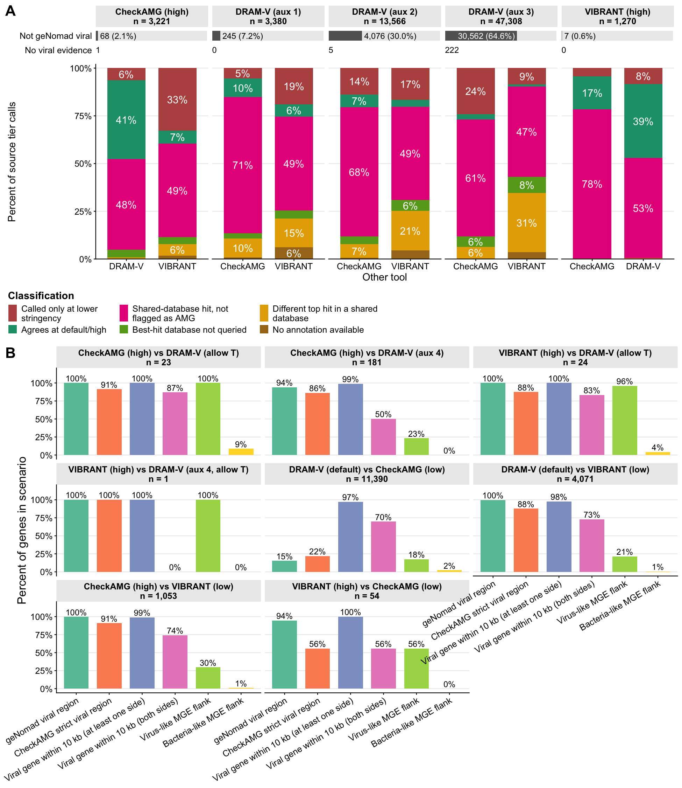<!-- -->

## All-tier UpSet by sequence source

The all-tier UpSet with the sequence-source track and bars split by
shared KO class as a single panel. The DRAM-V (default) function groups
are no longer part of this figure and are not drawn here.

``` r
ed_upset_height <- 8.5
save_plot_both(p_upset_all_tiers, "amg_all_tier_upset_by_sequence_source", 17, ed_upset_height, 300)
print(p_upset_all_tiers)
```

<!-- -->

# Source data export

Each panel’s plotted data frame is written out here, so the .xlsx source
data is assembled from the same objects the figures are drawn from
rather than recomputed elsewhere. The Figure 3 fill sensitivity counts
are computed in `amg_fig3_fill_sensitivity.ipynb`, checked here against
the panel A set labels and written with plain-language headers and a
README. The curation steps, the caution shares by basis and the
matched-level shared KO counts are copied from their tables, the shared
KO class labels follow the Figure 3 wording, and each file ships as a
separate CSV listed in fig3_README.txt or the README of its Extended
Data Figure.

``` r
SRC_DIR <- file.path(TBL_DIR, "source_data")
dir.create(SRC_DIR, showWarnings = FALSE, recursive = TRUE)

fill_rule_long <- function(data) {
  data %>%
    pivot_longer(c(fill_primary, fill_sensitivity), names_to = "rule", values_to = "shared_ko_class") %>%
    mutate(rule = recode(rule, fill_primary = "primary, best hit at e-value <= 1e-5",
                         fill_sensitivity = "sensitivity, KofamScan adaptive threshold"))
}
fig3_sets_pretty <- unname(fig3_tier_map)
# The README states the omission threshold as text
stopifnot(fig3_min_size == 12)
writeLines(c(
  "Source Data Figure 3",
  "",
  "What it is. The values behind Figure 3 (panels A to E) and behind the Figure 3 numbers cited in the text, one file per table. Figure 3A and every panel of Figure 3B omit UpSet intersections with fewer than 10 calls, and the intersection files list every intersection with the column shown set to FALSE for the omitted ones. In the files with a rule column that split calls by fill class (both fig3A files, fig3B_per_tool_upsets.csv, fig3_matched_levels_shared_ko_classes.csv and fig3_shared_ko_level_counts.csv), rule 'primary, best hit at e-value <= 1e-5' is the fill drawn in the figure, and rule 'sensitivity, KofamScan adaptive threshold' is reported here only. fig3_fill_sensitivity.csv uses its own rule values, 'primary' for the drawn fill and five sensitivity variants described in fig3_fill_sensitivity_README.txt. The fill classes are 'geNomad viral, Metabolism KO', 'geNomad viral, other KO', 'geNomad viral, no KO' and 'Not geNomad viral', from the best KofamScan hit of each protein in one shared KofamScan run. A Metabolism KO marks the function class of a call and does not confirm it as an AMG. Tiers are cumulative in every file, so each tier includes the calls of the stricter tiers of the same tool, and in the UpSet files a gene is TRUE in every set that contains it. DRAM-V (aux 1), (aux 2) and (aux 3) hold the calls of the default DRAM-V configuration at auxiliary score 1, at most 2 and at most 3, so DRAM-V (aux 3) is DRAM-V (default).",
  "",
  "Files:",
  "",
  "1. fig3A_all_tier_upset_by_intersection.csv (panel A intersection bars). One row per intersection of the nine panel A sets, fill class and rule, 256 rows. Columns: intersection, one Boolean column per set (CheckAMG (high), CheckAMG (medium), CheckAMG (low), DRAM-V (aux 1), DRAM-V (aux 2), DRAM-V (aux 3), VIBRANT (high), VIBRANT (medium), VIBRANT (low)), rule, shared_ko_class, n_calls, n_intersection, shown.",
  "2. fig3A_all_tier_upset_by_set.csv (panel A set-size bars and their labels). One row per set, rule and fill class, 72 rows. Set sizes count every gene kept by the primary-tier filter, including genes of omitted intersections. Columns: set, rule, shared_ko_class, n_calls, set_calls, set_viral_metabolism_ko, set_viral_metabolism_ko_share, set_label.",
  "3. fig3B_per_tool_upsets.csv (panel B). One row per focal tool, intersection, rule and fill class, 343 rows (CheckAMG 75, DRAM-V 214, VIBRANT 54). Columns: focal_tool, n_focal_calls, intersection, rule, shared_ko_class, n_calls, n_intersection, shown.",
  "4. fig3C_weight_shares.csv (panel C). One row per panel C tier (CheckAMG (high), DRAM-V (aux 1), VIBRANT (high)) and AMG weight bin, with 'Annotated, no AMG weight' and 'No annotation' as their own bins, 14 rows. Columns: tool, tier, AMG weight bin, n, pct, n_tier.",
  "5. fig3CE_weight_and_database.csv (panels C and E, per call). One row per call at CheckAMG (high), DRAM-V (aux 1) or VIBRANT (high), 7,871 rows, giving its AMG weight, weight bin, likely-AMG status and the database and hit of the annotation that represents it (highest AMG weight, otherwise strongest hit). Panel E is the share of each database within each tier. Columns: gene_key, tool, tier, AMG weight, AMG weight bin, Likely AMG, database, hit_id.",
  "6. fig3D_cautious_shares.csv (panel D). One row per panel D tier and cautious-function category, with not cautious split by AMG weight, all calls, 22 rows. Columns: tool, tier, Cautious functions, n, pct, n_tier.",
  "7. fig3D_cautious_functions_per_call.csv (panel D, per call). One row per call at CheckAMG (high), DRAM-V (aux 1) or VIBRANT (high), 7,871 rows, with the category assigned to it (the category least common within its tier when several match). Columns: gene_key, tier, Predicted AMG, tool, Cautious functions, Likely AMG.",
  "8. caution_shares_by_basis.csv (panel D basis, cited in the Results). One row per tool tier and population (all calls, geNomad-viral calls), 20 rows over ten tiers, giving the cautious share on all calls and on the calls with any weight, a scorable annotation or a weight of at least 0.6. Columns: tier, population, n_all_calls, cautious_all_calls, share_all_calls, n_any_weight, cautious_any_weight, share_any_weight, n_scorable, cautious_scorable, share_scorable, n_weight_ge_0.6, cautious_weight_ge_0.6, share_weight_ge_0.6, no_weight_cautious, no_weight_not_cautious.",
  "9. fig3_matched_levels_shared_ko_classes.csv (matched-level comparison cited in the Results). One row per matched level, rule, class scheme and class, 161 rows (72 for the four fill classes, 89 for the Class I/II split, a class with no call has no row). Levels: the nine sets of panel A, CheckAMG (high), (medium) and (low), DRAM-V (aux 1), (aux 2) and (aux 3), and VIBRANT (high), (medium) and (low), each counted over all calls of the tier rather than after the primary-tier filter. The first, second and third level of each tool are matched. classes is 'four-class' or 'Class I/II'. Class labels follow Figure 3: 'geNomad viral, Metabolism KO', 'geNomad viral, other KO', 'geNomad viral, no KO' and 'Not geNomad viral' for the fill classes, and 'geNomad viral, Class I', 'geNomad viral, Class II', 'geNomad viral, other KO', 'geNomad viral, no KO' and 'Not geNomad viral' for the Class I/II split. Columns: level, n_level, rule, classes, class, n_calls.",
  "10. fig3_shared_ko_level_counts.csv (matched-level and Class I/II counts cited in the Results and in Supplemental Table 9). One row per level and rule, 18 rows over the nine levels of fig3_matched_levels_shared_ko_classes.csv, counted over all calls of each tier (matched_level is 'true' on every row), giving the calls, the geNomad-viral calls, the calls with a shared KO and the count in each fill class and each Class I/II class. Columns: level, matched_level, rule, n_calls, n_genomad_viral, n_shared_ko, and one count column per class. The four fill-class columns are named 'fill class: ' plus the class label (for example 'fill class: geNomad viral, other KO'), and the five Class I/II columns are named 'Class I/II: ' plus the class label (for example 'Class I/II: geNomad viral, other KO'), with the same labels as in fig3_matched_levels_shared_ko_classes.csv.",
  "11. fig3_fill_sensitivity.csv with fig3_fill_sensitivity_README.txt (sensitivity analyses cited in Methods). One row per Figure 3 set and rule, 126 rows (21 sets under the primary rule and five sensitivity variants), giving the calls, the geNomad-viral calls and the number and share that are geNomad viral with a Metabolism KO. The panel column gives the group of each set: 'A, primary-tier filter' for the nine panel A tiers after the primary-tier filter, 'B focal, full tier' for the three panel B focal tiers in full and 'matched level, full tier' for the nine matched levels in full. Columns: panel, set, calls, geNomad viral calls, rule, viral, Metabolism KO calls, viral, Metabolism KO share. The variant definitions are in fig3_fill_sensitivity_README.txt, and all variants were compared after the primary counts had been seen.",
  "12. fig3_curation_steps.csv (curation steps cited in the Results, no panel). One row per step, 5 rows: all calls, geNomad-viral calls and geNomad-viral calls that also carry a DRAM distillate category for DRAM-V (default), and the first two steps for CheckAMG (high). Columns: tier, step_order, step, n_calls, share_of_all_calls.",
  "",
  "The level grid of measures is the second sheet of Supplemental Table 9, and the Extended Data Figure Source Data files are described in their own README files."
), file.path(SRC_DIR, "fig3_README.txt"))
readr::write_csv(fig3_upset_data %>% mutate(intersection = intersection_name(fig3_upset_data, fig3_sets_pretty)) %>%
                   fill_rule_long() %>% count(intersection, across(all_of(fig3_sets_pretty)), rule, shared_ko_class, name = "n_calls") %>%
                   left_join(fig3_all_intersections %>% select(intersection, n_intersection = n_calls, shown), by = "intersection"),
                 file.path(SRC_DIR, "fig3A_all_tier_upset_by_intersection.csv"))
readr::write_csv(bind_rows(lapply(fig3_sets_pretty, function(s) fig3_upset_data[fig3_upset_data[[s]], ] %>% mutate(set = s))) %>%
                   fill_rule_long() %>% count(set, rule, shared_ko_class, name = "n_calls") %>%
                   left_join(fig3_set_labels, by = "set"),
                 file.path(SRC_DIR, "fig3A_all_tier_upset_by_set.csv"))
readr::write_csv(bind_rows(lapply(names(fig3_focal), function(tool) {
                   sets <- unname(fig3_tier_map[fig3_focal[[tool]]$sets])
                   d <- fig3_focal_data[[tool]]
                   d %>% mutate(focal_tool = tool, n_focal_calls = nrow(d), intersection = intersection_name(d, sets)) %>%
                     fill_rule_long() %>% count(focal_tool, n_focal_calls, intersection, rule, shared_ko_class, name = "n_calls") %>%
                     left_join(fig3_focal_intersections[[tool]] %>% select(intersection, n_intersection = n_calls, shown), by = "intersection")
                 })),
                 file.path(SRC_DIR, "fig3B_per_tool_upsets.csv"))

fig3_matched_levels <- list(
  "CheckAMG (high)" = quo(CheckAMG_high), "DRAM-V (aux 1)" = quo(DRAMV_aux1), "VIBRANT (high)" = quo(VIBRANT_high),
  "CheckAMG (medium)" = quo(CheckAMG_high | CheckAMG_medium), "DRAM-V (aux 2)" = quo(DRAMV_aux2),
  "VIBRANT (medium)" = quo(VIBRANT_high | VIBRANT_medium),
  "CheckAMG (low)" = quo(CheckAMG_high | CheckAMG_medium | CheckAMG_low), "DRAM-V (aux 3)" = quo(DRAMV_aux3),
  "VIBRANT (low)" = quo(VIBRANT_high | VIBRANT_medium | VIBRANT_low)
)
class12_map <- c(
  "viral, Class I"    = "geNomad viral, Class I",
  "viral, Class II"   = "geNomad viral, Class II",
  "viral, other KO"   = "geNomad viral, other KO",
  "viral, no KO"      = "geNomad viral, no KO",
  "not geNomad viral" = "Not geNomad viral"
)
fig3_matched_counts <- bind_rows(lapply(names(fig3_matched_levels), function(level) {
  calls <- filter(fig3_genes, !!fig3_matched_levels[[level]])
  bind_rows(
    tibble(rule = "primary, best hit at e-value <= 1e-5", classes = "four-class", class = unname(four_class_map[calls$S_S2_fill])),
    tibble(rule = "sensitivity, KofamScan adaptive threshold", classes = "four-class", class = unname(four_class_map[calls$P_S2_fill])),
    tibble(rule = "primary, best hit at e-value <= 1e-5", classes = "Class I/II", class = unname(class12_map[calls$S_class12_fill])),
    tibble(rule = "sensitivity, KofamScan adaptive threshold", classes = "Class I/II", class = unname(class12_map[calls$P_class12_fill]))
  ) %>% count(rule, classes, class, name = "n_calls") %>% mutate(level = level, n_level = nrow(calls), .before = 1)
}))
stopifnot(!anyNA(fig3_matched_counts$class))
readr::write_csv(fig3_matched_counts, file.path(SRC_DIR, "fig3_matched_levels_shared_ko_classes.csv"))

# Computed by amg_fig3_fill_sensitivity.ipynb, renamed here for readers
fig3_fill_rules <- c(
  primary = "primary", nucleotide_excluded_strict = "nucleotide excluded, strict",
  nucleotide_excluded_lenient = "nucleotide excluded, lenient", cautious_shared_ko = "cautious excluded, CheckAMG list on shared KO",
  cautious_tool_own = "cautious excluded, calling tool's own flag", adaptive_threshold = "KofamScan adaptive threshold"
)
fig3_fill_sensitivity <- readr::read_tsv(file.path(TBL_DIR, "fig3_fill_sensitivity.tsv"), show_col_types = FALSE)
fig3_fill_sensitivity_long <- fig3_fill_sensitivity %>%
  select(panel, set, n_calls, n_genomad_viral, all_of(names(fig3_fill_rules))) %>%
  pivot_longer(all_of(names(fig3_fill_rules)), names_to = "rule", values_to = "viral_metabolism_ko_calls") %>%
  mutate(rule = factor(unname(fig3_fill_rules[rule]), levels = unname(fig3_fill_rules)),
         set = recode(set, !!!as.list(c(fig3_tier_map, DRAMV_default = "DRAM-V (default)"))),
         viral_metabolism_ko_share = viral_metabolism_ko_calls / n_calls) %>%
  arrange(factor(panel, levels = unique(fig3_fill_sensitivity$panel)), rule) %>%
  dplyr::rename(calls = n_calls, `geNomad viral calls` = n_genomad_viral,
                `viral, Metabolism KO calls` = viral_metabolism_ko_calls, `viral, Metabolism KO share` = viral_metabolism_ko_share)
fig3_label_check <- fig3_fill_sensitivity_long %>%
  filter(panel == "A, primary-tier filter", rule == "primary") %>%
  inner_join(fig3_set_labels, by = "set")
stopifnot(nrow(fig3_label_check) == nrow(fig3_set_labels),
          all(fig3_label_check$calls == fig3_label_check$set_calls),
          all(fig3_label_check$`viral, Metabolism KO calls` == fig3_label_check$set_viral_metabolism_ko))
readr::write_csv(fig3_fill_sensitivity_long, file.path(SRC_DIR, "fig3_fill_sensitivity.csv"))
writeLines(c(
  "fig3_fill_sensitivity.csv: calls of each Figure 3 set that are geNomad viral with a Metabolism KO, the deep magenta fill, under the primary rule and five sensitivity variants.",
  "",
  "Sets: the nine tiers of panel A after the primary-tier filter (panel 'A, primary-tier filter'), the three focal tiers of panel B in full (panel 'B focal, full tier') and the nine matched levels in full (panel 'matched level, full tier'), 21 sets and 126 rows. Tiers are cumulative, so each tier includes the calls of the stricter tiers of the same tool, and DRAM-V (aux 1), (aux 2) and (aux 3) hold the calls of the default DRAM-V configuration at auxiliary score 1, at most 2 and at most 3, so DRAM-V (aux 3) is DRAM-V (default).",
  "",
  "primary: the fill drawn in the figure. A geNomad-viral call whose shared KofamScan KO, the best hit at e-value <= 1e-5, sits anywhere under KEGG Metabolism.",
  "",
  "nucleotide excluded, strict: as primary, but a KO that KEGG places under Nucleotide metabolism is removed even when it is also placed under another Metabolism category.",
  "",
  "nucleotide excluded, lenient: as primary, but a KO is removed only when Nucleotide metabolism is its only Metabolism category.",
  "",
  "cautious excluded, CheckAMG list on shared KO: as primary, but a KO that the CheckAMG cautious-function list (AMG_filters.tsv) flags as essential, glucan, lipid, methyl or nucleotide is removed.",
  "",
  "cautious excluded, calling tool's own flag: as primary, but a call is removed when the annotation the calling tool itself used is flagged cautious.",
  "",
  "KofamScan adaptive threshold: a geNomad-viral call with any KofamScan hit above the adaptive threshold whose KO sits under KEGG Metabolism.",
  "",
  "Shares are of all calls in the set. The variants were defined and compared after the primary counts had been seen, so they show how much the counts depend on the class definition and do not replace the primary rule."
), file.path(SRC_DIR, "fig3_fill_sensitivity_README.txt"))


readr::write_csv(amg_weight_comp_fig3 %>%
                   select(gene_key, tool, tier, `AMG weight`, `AMG weight bin`,
                          `Likely AMG`, database, hit_id),
                 file.path(SRC_DIR, "fig3CE_weight_and_database.csv"))
readr::write_csv(amg_weight_comp_fig3 %>%
                   filter(`Predicted AMG`) %>%
                   composition_shares(`AMG weight bin`),
                 file.path(SRC_DIR, "fig3C_weight_shares.csv"))
readr::write_csv(amg_cautious_comp_fig3,
                 file.path(SRC_DIR, "fig3D_cautious_functions_per_call.csv"))
readr::write_csv(amg_cautious_comp_fig3 %>%
                   filter(`Predicted AMG`) %>%
                   composition_shares(`Cautious functions`),
                 file.path(SRC_DIR, "fig3D_cautious_shares.csv"))

writeLines(c(
  "Source Data Extended Data Figure 4",
  "",
  "What it is. The values behind Extended Data Figure 4: the size of each tool's AMG reference (panel A), the reference HMM profiles shared between the tools (panel B), and the source database of the calls at every tool tier (panel C), one file per panel.",
  "",
  "Files:",
  "",
  "1. edfig4A_reference_set_sizes.csv (panel A). Number of KO and Pfam entries in each tool's AMG reference, with CheckAMG shown for all references and for the subset at AMG weight at least 0.6, 8 rows. Columns: tool, Reference set, Entry type, Reference entries.",
  "2. edfig4B_reference_hmm_membership.csv (panel B). One row per reference HMM profile in the reference of at least one of the three tools, 60,859 rows, with the databases that hold the profile and its membership in each tool's reference. Database source is one of dbCAN, CAMPER (custom), METABOLIC (custom), FOAM, KEGG or Pfam, and n_databases counts the databases that hold the profile. Panel B counts HMM profiles, so its totals differ from the entry counts of panel A. Columns: HMM, CAMPER, FOAM, KEGG, METABOLIC, Pfam, dbCAN, CheckAMG (AMG weight >= 0.6), CheckAMG (all), DRAMV, VIBRANT, n_databases, Database source, CheckAMG (AMG weight < 0.6), DRAM-V. The columns DRAMV and DRAM-V hold the same values.",
  "3. edfig4C_database_composition_all_tiers.csv (panel C). One row per tool tier and source database of the annotation that represents each call (highest AMG weight, otherwise strongest hit), 51 rows over 12 tiers (CheckAMG (high), CheckAMG (medium), CheckAMG (low), DRAM-V (aux 1), DRAM-V (aux 2), DRAM-V (aux 3), DRAM-V (allow T), DRAM-V (aux 4), DRAM-V (aux 4, allow T), VIBRANT (high), VIBRANT (medium), VIBRANT (low)), with the number of calls and their share of the tier. Databases: KEGG, Pfam, FOAM, METABOLIC (custom), CAMPER (custom), PHROG, dbCAN, MEROPS and No annotation. dbCAN and MEROPS occur only for DRAM-V, and No annotation only for CheckAMG. Each call is counted at every tier it belongs to. CheckAMG and VIBRANT tiers are cumulative, as in Figure 3, so each tier includes the calls of the tiers above it. DRAM-V (aux 1), (aux 2) and (aux 3) hold the calls of the default DRAM-V configuration at auxiliary score 1, at most 2 and at most 3, as in Figure 3, so DRAM-V (aux 3) holds all 47,308 default calls. DRAM-V (allow T), (aux 4) and (aux 4, allow T) are full configurations that include the default calls, 52,012, 160,941 and 171,833 calls. The shares of each tier sum to 1. Columns: tool, tier, database, n, pct."
), file.path(SRC_DIR, "edfig4_README.txt"))
readr::write_csv(reference_set_sizes,
                 file.path(SRC_DIR, "edfig4A_reference_set_sizes.csv"))
readr::write_csv(dplyr::rename(reference_upset_data, `CheckAMG (AMG weight >= 0.6)` = `CheckAMG (AMG weight ≥ 0.6)`),
                 file.path(SRC_DIR, "edfig4B_reference_hmm_membership.csv"))
readr::write_csv(db_comp_plot,
                 file.path(SRC_DIR, "edfig4C_database_composition_all_tiers.csv"))

writeLines(c(
  "Source Data Extended Data Figure 5",
  "",
  "What it is. The values behind Extended Data Figure 5: the number of calls at every tool tier (panel A), and the AMG-weight composition (panel B) and cautious-function composition (panel C) of the calls at every tier, one file per panel. All three files use the 12 tiers of Extended Data Figure 4C (CheckAMG (high), CheckAMG (medium), CheckAMG (low), DRAM-V (aux 1), DRAM-V (aux 2), DRAM-V (aux 3), DRAM-V (allow T), DRAM-V (aux 4), DRAM-V (aux 4, allow T), VIBRANT (high), VIBRANT (medium), VIBRANT (low)). Each call is counted at every tier it belongs to. CheckAMG and VIBRANT tiers are cumulative, as in Figure 3, so each tier includes the calls of the tiers above it. DRAM-V (aux 1), (aux 2) and (aux 3) hold the calls of the default DRAM-V configuration at auxiliary score 1, at most 2 and at most 3, as in Figure 3, so DRAM-V (aux 3) holds all 47,308 default calls. DRAM-V (allow T), (aux 4) and (aux 4, allow T) are full configurations that include the default calls, 52,012, 160,941 and 171,833 calls. In the panel B and C files pct is a share of n_tier, from 0 to 1.",
  "",
  "Files:",
  "",
  "1. edfig5A_tier_call_totals.csv (panel A). Number of calls at each tier, for all calls and for likely AMGs (best annotation at AMG weight at least 0.6), 24 rows. Call set is 'all_calls' or 'likely_amgs'. Columns: tool, tier, Call set, AMG calls.",
  "2. edfig5B_weight_composition_all_tiers.csv (panel B). One row per tier and AMG weight bin, 58 rows, with the bins 'AMG weight ≥ 0.8', 'AMG weight 0.6 to 0.8', 'AMG weight 0.4 to 0.6', 'AMG weight < 0.4', 'Annotated, no AMG weight' and 'No annotation'. n_tier is the number of calls of the tier, for example 6,728 for CheckAMG (medium), 170,161 for CheckAMG (low) and 160,941 for DRAM-V (aux 4). Columns: tool, tier, AMG weight bin, n, pct, n_tier.",
  "3. edfig5C_cautious_composition_all_tiers.csv (panel C). One row per tier and cautious-function category, with not cautious split by AMG weight, 91 rows. Categories: Essential gene, Nucleotide metabolism, Glucan metabolism, Lipid metabolism, Methylation, Not cautious (weight ≥ 0.6), Not cautious (weight < 0.6) and Not cautious (no weight). n_tier is as in panel B. Columns: tool, tier, Cautious functions, n, pct, n_tier."
), file.path(SRC_DIR, "edfig5_README.txt"))
readr::write_csv(tier_call_totals,
                 file.path(SRC_DIR, "edfig5A_tier_call_totals.csv"))
readr::write_csv(weight_comp_plot,
                 file.path(SRC_DIR, "edfig5B_weight_composition_all_tiers.csv"))
readr::write_csv(cautious_comp_plot,
                 file.path(SRC_DIR, "edfig5C_cautious_composition_all_tiers.csv"))

writeLines(c(
  "Source Data Extended Data Figure 6",
  "",
  "What it is. The values behind Extended Data Figure 6: the reasons the other tools did not match each call of a primary tier (panel A), and the genomic context of the genes in each tier-conflict scenario (panel B). Panel A is counted per gene. In edfig6A_nonoverlap_reasons.csv and edfig6B_tier_conflict_context.csv pct is a share, from 0 to 1.",
  "",
  "Files:",
  "",
  "1. edfig6A_nonoverlap_reasons.csv (panel A). One row per source tier, other tool and reason, 57 rows. A reason with no gene has no row. source_tier is CheckAMG_high, DRAMV_aux1, DRAMV_aux_le2, DRAMV_aux_le3 or VIBRANT_high, drawn in the panel as CheckAMG (high), DRAM-V (aux 1), DRAM-V (aux 2), DRAM-V (aux 3) and VIBRANT (high). The DRAM-V levels are cumulative, as in Figure 3: DRAM-V (aux 1), (aux 2) and (aux 3) hold the calls of the default DRAM-V configuration at auxiliary score 1, at most 2 and at most 3, so DRAMV_aux_le3 holds all default calls. For each source tier and other tool, every gene of the source tier takes one reason, so n sums to the calls of the source tier (3,221 for CheckAMG high, 3,380, 13,566 and 47,308 for DRAM-V (aux 1), (aux 2) and (aux 3), and 1,270 for VIBRANT high). Classification gives the reason: Called only at lower stringency, Agrees at default/high, Best-hit database not queried, Shared-database hit, not flagged as AMG, Different top hit in a shared database, or No annotation available. Other tool is the tool whose response is classified (CheckAMG, DRAM-V or VIBRANT). Columns: source_tier, n, pct, Classification, Other tool.",
  "2. edfig6A_no_viral_evidence_counts.csv (panel A facet labels and legend counts). One row per source tier, 5 rows, giving the calls of the tier, the calls not on a geNomad-viral region, and the calls with no viral evidence (not on a geNomad-viral region, not in a CheckAMG strict viral region and with no gene of V-score at least 10 within 10 kb on either side). The DRAMV_aux_le3 row, which holds all default DRAM-V calls, has 30,562 calls not on a geNomad-viral region and 222 with no viral evidence. facet_label is the panel label, for example 'CheckAMG (high), n = 3,221' or 'DRAM-V (aux 3), n = 47,308'. Columns: source_tier, n_calls, n_without_viral_evidence, n_not_genomad_viral, pct_not_genomad_viral, facet_label.",
  "3. edfig6B_scenario_sizes.csv (panel B facet labels). One row per tier-conflict scenario, 8 rows, giving the number of genes in the scenario. A scenario holds the genes in the first tool's primary tier that the second tool clears only at the named weaker configuration and not at its own primary tier. facet_label is the panel label, for example 'CheckAMG (high) vs DRAM-V (aux 4), n = 181'. Columns: Scenario, n_genes, facet_label.",
  "4. edfig6B_tier_conflict_context.csv (panel B). One row per scenario and genomic-context signal, 48 rows (8 scenarios and 6 signals), giving the genes of the scenario and the number and share with the signal. Signals: geNomad viral region, CheckAMG strict viral region, Viral gene within 10 kb (at least one side), Viral gene within 10 kb (both sides), Virus-like MGE flank and Bacteria-like MGE flank. Columns: Scenario, Context signal, n_genes, n_with_signal, pct."
), file.path(SRC_DIR, "edfig6_README.txt"))
# Line breaks are for the facet strips only
flatten_breaks <- function(data) mutate(data, across(where(function(x) is.character(x) || is.factor(x)),
                                                     function(x) str_replace_all(as.character(x), "\n", ", ")))
stopifnot(identical(unname(nonoverlap_category_map[nonoverlap_summary$category]), as.character(nonoverlap_summary$Classification)),
          identical(unname(pretty_tool(nonoverlap_summary$other_tool)),as.character(nonoverlap_summary$`Other tool`)))
# Codes of the cumulative DRAM-V sets as in Supplemental Table 9 sheet 2
cumulative_export_codes <- c(DRAMV_aux2 = "DRAMV_aux_le2", DRAMV_aux3 = "DRAMV_aux_le3")
readr::write_csv(nonoverlap_summary %>% select(-category, -other_tool) %>%
                   mutate(source_tier = recode(as.character(source_tier), !!!cumulative_export_codes)) %>% flatten_breaks(),
                 file.path(SRC_DIR, "edfig6A_nonoverlap_reasons.csv"))
readr::write_csv(source_tier_facet_labels %>% mutate(source_tier = recode(as.character(source_tier), !!!cumulative_export_codes)) %>%
                   flatten_breaks(),
                 file.path(SRC_DIR, "edfig6A_no_viral_evidence_counts.csv"))
readr::write_csv(flatten_breaks(tier_conflict_context),
                 file.path(SRC_DIR, "edfig6B_tier_conflict_context.csv"))
readr::write_csv(flatten_breaks(scenario_facet_labels),
                 file.path(SRC_DIR, "edfig6B_scenario_sizes.csv"))

readr::write_csv(ed7_upset_data %>% count(source, shared_ko_class, across(all_of(unname(ed7_tier_map))), name = "n_calls"),
                 file.path(SRC_DIR, "edfig7A_all_tier_upset_by_sequence_source.csv"))

# Read as text so the cells keep the written values, since write_csv can print a double as 0.86240000000000006
read_tsv_as_text <- function(path) readr::read_tsv(path, col_types = readr::cols(.default = "c"), na = character())
# Shortest round-trip digits with a trailing .0, as Python writes a double, so the CSV keeps its bytes
python_float <- function(x) vapply(x, function(v) {
  text <- trimws(formatC(v, digits = Position(function(d) as.numeric(formatC(v, digits = d, format = "g")) == v, 1:17), format = "g"))
  if (grepl("[.e]", text)) text else paste0(text, ".0")
}, character(1))
readr::write_csv(curation_steps %>% mutate(share_of_all_calls = python_float(share_of_all_calls)),
                 file.path(SRC_DIR, "fig3_curation_steps.csv"))
readr::write_csv(read_tsv_as_text(file.path(TBL_DIR, "caution_shares_by_basis.tsv")),
                 file.path(SRC_DIR, "caution_shares_by_basis.csv"))
shared_ko_level_counts <- read_tsv_as_text(file.path(TBL_DIR, "shared_ko_level_counts.tsv"))
relabel_class_column <- function(col) {
  scheme <- sub(": .*", "", col)
  label <- sub("^[^:]*: ", "", col)
  ifelse(scheme == "four_class", paste0("fill class: ", four_class_map[label]),
         ifelse(scheme == "class12", paste0("Class I/II: ", class12_map[label]), col))
}
shared_ko_level_counts_fig3 <- shared_ko_level_counts %>%
  select(-rule) %>%
  dplyr::rename(rule = rule_label) %>%
  rename_with(relabel_class_column)
stopifnot(!any(grepl("NA$", names(shared_ko_level_counts_fig3))), !anyDuplicated(names(shared_ko_level_counts_fig3)),
          sum(startsWith(names(shared_ko_level_counts_fig3), "fill class: ")) == 4,
          sum(startsWith(names(shared_ko_level_counts_fig3), "Class I/II: ")) == 5)
readr::write_csv(shared_ko_level_counts_fig3, file.path(SRC_DIR, "fig3_shared_ko_level_counts.csv"))
writeLines(c(
  "Source Data Extended Data Figure 7",
  "",
  "edfig7A_all_tier_upset_by_sequence_source.csv (Extended Data Figure 7). One row per combination of sequence source, shared KO class and membership in the 12 sets of the figure, 464 rows covering the 306,534 genes called as an AMG at any tier by any tool, which form 92 intersections. Sources: Viromes (198 rows, 189,143 genes), Mixed metagenomes (151 rows, 114,550 genes) and Viral genomes (115 rows, 2,841 genes). Shared KO classes under the primary rule, as in Figure 3: geNomad viral, Metabolism KO (222 rows, 21,125 genes), geNomad viral, other KO (119 rows, 8,339 genes), geNomad viral, no KO (48 rows, 2,886 genes) and Not geNomad viral (75 rows, 274,184 genes). The annotation track is the sequence-source share of each intersection, and the intersection and set-size bars are split by shared_ko_class. Set-size labels give the calls of the set, then the calls and share of the set in each class. The sets are the nine tiers of Figure 3 and three further DRAM-V configurations. Tiers are cumulative, so each tier includes the calls of the stricter tiers of the same tool and a gene is TRUE in every set that contains it. DRAM-V (aux 1), (aux 2) and (aux 3) hold the calls of the default DRAM-V configuration at auxiliary score 1, at most 2 and at most 3, and DRAM-V (allow T), (aux 4) and (aux 4, allow T) are full configurations that include the default calls. Columns: source, shared_ko_class, one Boolean column per set (CheckAMG (high), CheckAMG (medium), CheckAMG (low), DRAM-V (aux 1), DRAM-V (aux 2), DRAM-V (aux 3), DRAM-V (allow T), DRAM-V (aux 4), DRAM-V (aux 4, allow T), VIBRANT (high), VIBRANT (medium), VIBRANT (low)), n_calls. Set sizes from this file are the tier totals, matching Extended Data Figure 5A."
), file.path(SRC_DIR, "edfig7_README.txt"))

tibble::tibble(file = list.files(SRC_DIR, pattern = "[.]csv$")) %>%
  mutate(rows = vapply(file, function(f) nrow(readr::read_csv(file.path(SRC_DIR, f), show_col_types = FALSE)), integer(1)))
```

    ## # A tibble: 24 × 2
    ##    file                                        rows
    ##    <chr>                                      <int>
    ##  1 caution_shares_by_basis.csv                   20
    ##  2 edfig4A_reference_set_sizes.csv                8
    ##  3 edfig4B_reference_hmm_membership.csv       60859
    ##  4 edfig4C_database_composition_all_tiers.csv    51
    ##  5 edfig5A_tier_call_totals.csv                  24
    ##  6 edfig5B_weight_composition_all_tiers.csv      58
    ##  7 edfig5C_cautious_composition_all_tiers.csv    91
    ##  8 edfig6A_no_viral_evidence_counts.csv           5
    ##  9 edfig6A_nonoverlap_reasons.csv                57
    ## 10 edfig6B_scenario_sizes.csv                     8
    ## # ℹ 14 more rows
